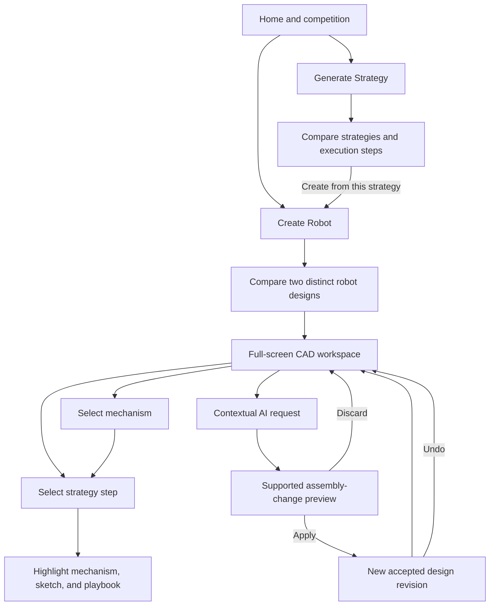

# Tachyon — Product Requirements

Tachyon is a new mobile-first AI robotics design application for a VEX team member
who wants to understand a competition, compare credible robot concepts, inspect
their actual component assemblies, and make supported design changes.

Source: [approved scope](scope.md), particularly **The Unique Kernel**, **The Core
Loop**, **Inspiration & Identity**, **What "Working" Looks Like**, and **The POC
Boundary**; [established product vision](../docs/product-vision.md); and the
learner's request to prioritize visual identity, intuitive navigation, mobile
interaction, and genuine functionality. This document defines product behavior,
not implementation architecture. All acceptance criteria describe required future
behavior; this planning document does not establish implementation or verification.

## The Core Journey

Source: `scope.md > The Core Loop` and `What "Working" Looks Like`.

1. Open Tachyon. See the current competition, defaulting to Override, and two
   equally prominent actions: **Generate Strategy** and **Create Robot**.
2. Keep the selected competition or upload a supported VEX PDF. Review its
   identified version, extracted objectives, scoring opportunities, relevant
   constraints, and any unresolved facts through links to source pages.
3. Starting with **Generate Strategy** produces at least two distinct approaches
   with objectives, rationale, required mechanisms, risks, and execution steps.
   The user can inspect these without creating or viewing a robot.
4. Starting with **Create Robot** accepts a description and priorities, with
   sensible competition-driven defaults when the user supplies neither. It
   derives the strategy context internally without requiring a prior strategy
   session. A chosen existing strategy can enter the same creation flow.
5. Compare two mechanically distinct, competition-aware designs. Identify their
   actual architectural differences, supported actions, tradeoffs, and readiness.
   Open either candidate in the full-screen CAD workspace.
6. Orbit and inspect the connected component assembly. Select a strategy step to
   highlight and explain its mechanism, inspect the linked sketch/playbook, and
   operate an available joint animation. Selecting a mechanism reveals its
   supported strategy actions in the opposite direction.
7. Enter a contextual request in the small top-left AI core. Explanations answer
   in place. Supported engineering changes show a labeled preview and affected
   components; **Apply changes** creates a visible design revision. **Discard
   preview** keeps the accepted design. **Undo** restores the preceding revision.
8. Compare or refine the other candidate, switch theme or layout, and return to
   the same workspace without losing accepted design state or preferences.

The defining success moment is selecting a strategy step, seeing its actual
mechanism highlighted, and then applying a supported AI request that changes the
same assembly. A written explanation or a camera movement alone does not prove
CAD modification.

## Screens and Layout

Source: `scope.md > The Core Loop`, `Inspiration & Identity`, and `The POC Boundary`.
These are product surfaces, not a requirement for separate pages for every tool.
Strategy, components, sources, and assistant views reuse context when opened
inside a design. There is no intervening statistics dashboard.

| Surface | Desktop layout | Phone layout | Main transitions |
| --- | --- | --- | --- |
| **S1 — Home and competition** | Tachyon identity, competition selector/version, equal-weight Generate Strategy/Create Robot actions, optional Resume workspace action, compact appearance/preferences access | Competition above two large stacked actions; no permanent sidebar or filler statistics | Open competition/source details, upload PDF, enter either workflow, or resume |
| **S2 — Strategy workspace** | Competition and Back at the top; clear strategy selector; objective/rationale, ordered actions, mechanism needs, and field playbook with progressive detail | One strategy at a time with an obvious switcher; readable action list and expandable sketch/field view | Create from selected strategy, inspect source, return Home; when a robot exists, reuse this content in its Strategy panel |
| **S3 — Robot request and comparison** | Brief optional description/priorities followed by generation; two candidate previews side by side with consistent views and meaningful differences | Compact request surface; vertically readable candidates or one candidate plus an explicit comparison switcher; no squeezed dual CAD panes | Generate, retry a failed candidate, inspect either design, or return to its strategy |
| **S4 — CAD workspace** | Full-window CAD base; small top-left AI core; compact active-design context; dismissible tool access; panels appear through chosen layouts | CAD fills the usable screen and respects device safe areas; compact core at top-left, reachable tool launcher, one expanded content sheet at a time | Strategy, Components, Designs, View controls, selection actions, Preferences, and Home/Back |
| **S5 — Assistant expansion** | Core opens a contextual side panel; optional full-screen assistant for a longer review; state controls inside the assistant | Core expands into a resizable bottom sheet; full-screen assistant uses the available screen; keyboard does not hide input or Apply/Discard | Compact ↔ expanded ↔ full-screen; return preserves robot, selection, camera, draft command, and pending proposal |
| **Contextual sources and preferences** | A dismissible panel/popover with a clear title and close action | A readable sheet or temporary full-screen source view with Back | Return to the exact originating action, rule, or workspace; no duplicate navigation hierarchy |

### Home and First Use

Show what the application does through its two actions and the selected competition.
Do not force onboarding slides, an account, an upload, or a strategy questionnaire
before reaching either entry point. A missing optional robot description must
not disable competition-based creation. A default rulebook problem appears as an
actionable competition state rather than an empty or fabricated ready screen.

### CAD Workspace Composition

The robot is the visual focus. The canvas covers the workspace rather than
occupying a card inside a dashboard. Floating/docked controls are justified by
the current task and can be hidden. A discoverable reopen control remains when
panels are dismissed. Selecting an object creates one contextual inspector;
the same selection must not produce competing inspectors in multiple corners.

The top-left core remains distinct from the application title and active-design
label. Labels identify the current candidate and accepted revision; a preview is
visibly labeled **Preview**. Status appears near the operation it describes.
Avoid an always-visible list of build metrics or meaningless model confidence.

The primary workspace tools are **Strategy**, **Components**, **Designs**, and
**View**. Advanced inspection and layout/preferences are progressively exposed.
The prominent Strategy action is available for every design. Assistant state
controls appear only within the core, bubble, panel, or full-screen assistant.

### Navigation and Context Continuity

- Home/Back returns to the previous meaningful surface. Creating a robot from a
  strategy preserves the competition and selected strategy; inspecting another
  candidate preserves each candidate's own selection and view context.
- Selecting a strategy step changes the active mechanism context without making
  the user navigate into an unrelated application surface.
- Switching candidates changes the complete active design, strategy links, and
  AI context together. Edits to candidate A do not silently change candidate B.
- Phone drawers and temporary source views have clear Back/Close actions.
  Desktop Escape dismisses the active temporary view when appropriate; it does
  not silently discard an engineering proposal or erase an input draft.
- Selecting a different competition explicitly starts a new generation context.
  Existing designs retain the competition/source version that produced them.
  They must not be relabeled as grounded in the newly selected rules.

## Look and Feel

Source: `scope.md > Inspiration & Identity`. The learner has already established
the design direction; this PRD carries those answers forward without a new
design interview. Exact typefaces and detailed styling remain implementation
choices to review in the technical specification.

### Shared Identity — Complicatedly Simple

Tachyon should feel like a professional mechanical design application: refined,
precise, tactile, and understandable. Keep text legible on phones, maintain clear
hierarchy, and use plain action labels. The robot and its subsystem relationships
supply visual interest. Avoid marketing blocks, excessive sci-fi chrome, childish
toy styling, unexplained icons, or ornament competing with CAD geometry.

Text uses a readable professional character; dimensions and component details
remain easy to scan. Icon-only actions have accessible names, desktop explanations,
and usable phone equivalents. Selection, warnings, and availability are conveyed
through labels/shape/emphasis as well as color.

### SNAP

Warm off-white, graphite, and metallic gray with controlled yellow, blue, and red
accents. Panels and controls feel modular and fitted together. Snapping/docking
feedback, clear subsystem grouping, and brief piecewise assembly motion reinforce
mechanical relationships. The core's compact modules join and separate. Preserve
real component materials and identification rather than recoloring geometry into
toy bricks or copying LEGO branding.

### SHIFT

Gunmetal and titanium with electric blue and subtle copper/orange highlights.
Controls unfold, panels expand, and the compact shell transforms with physically
understandable motion. Keep labels and edges readable against the dark canvas;
metallic decoration must not hide geometry or important controls. Avoid copied
Transformers branding, long cinematic transitions, or incessant animated effects.

### Theme and Motion Consistency

Both themes expose the same actions in the same logical places and share
engineering data. Theme changes retain camera, selected components, generation
progress, workspace layout, command drafts, and pending changes. SNAP and SHIFT
differ in surfaces, feedback, and motion character; their mechanics do not alter
the generated robot. Reduced motion replaces transformations, camera flights,
and assembly transitions with immediate or quiet state changes. Do not use
animation as the sole indication that an operation is working or complete.

## Features and Behavior

Acceptance identifiers below provide stable references for later planning and
verification. All criteria describe required POC outcomes; the technical
specification stages their verification. They are not a completed-test record.

### F1 — Competition Selection and Rulebook Review

Source: `scope.md > The Core Loop` and `The POC Boundary`.

Provide default Override with source/version identity and an Upload rulebook
action. A supported PDF goes through readable stages such as reading, extracting,
and ready for review. Present objectives, scoring opportunities, and relevant
robot/game constraints. Each extracted rule or fact exposes its original
document/page/section and distinguishes source statements from AI interpretation.

Show unclear or missing information close to the affected item. When an essential
constraint is unresolved, explain what generation cannot establish; do not invent
it, claim legality, or silently borrow a different competition's facts. Supported
competitions are identified honestly; accepting a PDF file is not proof that its
game is fully supported. Uploading another rulebook must not destroy existing
projects or alter the default source.

| ID | Acceptance criterion |
| --- | --- |
| COMP-1 | A fresh workspace can select default Override without a PDF upload and inspect its source/version. |
| COMP-2 | Another supported VEX PDF produces competition facts through the same visible workflow; a fact opens its corresponding source page/section. |
| COMP-3 | Invalid, encrypted/unreadable, incomplete, or unsupported documents produce a specific status and a usable retry/replacement path; none produces invented rules. |
| COMP-4 | Switching competition or source version invalidates stale generation context while retaining existing designs under their original context. |

### F2 — Standalone Strategy Generation

Source: `scope.md > The Unique Kernel`, `The Core Loop`, and `The POC Boundary`.

Generate at least two distinct AI-produced strategies for the selected supported
competition. Each includes objective, rationale, scoring opportunities, ordered
execution steps, required mechanisms, autonomous/driver considerations where
supported, and tradeoffs/assumptions. Ground rule-dependent statements in the
selected document. Proposed tactics, route sketches, and expected behavior are
not verified scoring predictions.

Users can inspect a step, its explanation, its competition references, and its
field playbook before a robot exists. In that state, mechanism requirements are
labeled **Required mechanism**, not highlighted as existing hardware. **Create
robot from this strategy** carries the selected approach into robot creation.
An unavailable AI service returns a clear failure; static examples cannot be
presented as fresh model-generated results.

| ID | Acceptance criterion |
| --- | --- |
| STRAT-1 | Generate Strategy works from Home with no robot and returns at least two substantively different approaches. |
| STRAT-2 | Each approach exposes objectives, mechanism needs, execution sequence, rationale, tradeoffs, and relevant rule sources. |
| STRAT-3 | Creating from a selected strategy retains its competition/version and action identities through the resulting design. |
| STRAT-4 | Failure, cancel, and retry retain the user's competition and inputs; failed or example output is never labeled successful AI generation. |

### F3 — Robot Requests, Architecture Generation, and Comparison

Source: `scope.md > The Core Loop` and `What "Working" Looks Like`.

Create Robot accepts optional plain-language intent and priorities, or a selected
strategy. It can start from competition rules alone. Do not force users through
the standalone Strategy screen. Generation explains its real stages and produces
two mechanically different candidate architectures with associated strategies.

Each candidate shows a name, objective, architecture/mechanism summary, meaningful
differences, supported actions, tradeoffs, readiness, and a preview derived from
its actual assembly when available. Textual architecture proposals may appear
before CAD is ready, but remain labeled **Architecture proposed**. A failed
assembly cannot be promoted by a convincing illustration. Do not assert a best
robot, legality, predicted score, or calibrated performance without evidence.

Desktop comparison uses consistent camera views and comparable detail. Phones
use readable candidate switching or vertical comparison. Selecting either opens
that candidate's CAD; the other remains accessible under Designs. If one fails,
keep the successful result and explain the failed candidate's missing capability.
Two successful designs remain a completion requirement for this POC.

| ID | Acceptance criterion |
| --- | --- |
| ROBOT-1 | Create Robot from a fresh workspace generates from rules without a prior strategy session or mandatory description. |
| ROBOT-2 | Both candidates have competition-aware strategies and demonstrable differences in mechanism arrangement, subsystem type, chassis/power architecture, or operational approach; cosmetic changes alone fail. |
| ROBOT-3 | Both candidates are inspectable as complete conceptual component assemblies under F4; a failed or incomplete alternative is clearly labeled and does not count toward completion. |
| ROBOT-4 | Comparison identifies the actual mechanical differences and tradeoffs; opening and switching candidates preserves the correct strategy/assembly associations. |
| ROBOT-5 | Generation failure and partial success preserve existing accepted designs and expose specific retry or revise-request actions. |

### F4 — Authentic Components and Connected Conceptual Assemblies

Source: `scope.md > What "Working" Looks Like`, `The POC Boundary`, and
`Explicitly Cut`.

Use detailed authentic VEX component geometry with established usable licenses,
accurate identity, scale, transforms, and provenance. Relevant parts include
structure, wheels, motors/mounts, shafts/transmission, bearings, retention,
fasteners, acquisition/handling, and scoring mechanisms. The curated catalog
may be small; unsupported components or architectures remain explicit limits.

A **complete conceptual robot assembly** has a connected chassis, strategy-
appropriate acquisition/retention and scoring functions, mounted and supported
subsystems, actual actuation/transmission paths, and the required supporting
components. A single subsystem may serve more than one function when the real
architecture explains how. Necessary power/control hardware and its placement
must be accounted for; unavailable required geometry is a stated completeness
gap. A bare shaft, drivetrain, floating end effector, or unmounted collection of
parts is not a complete robot.

Expose component → subsystem → robot hierarchy, actual mounting/connection
relationships, and joints with valid moving members and known limits. Display
meshes remain distinguishable from their source CAD and from illustrative
geometry. Do not stretch source parts to invent sizes or replace missing hardware
with generic primitives presented as authentic parts. A source-geometry check,
assembly relationship check, conceptual task support, competition legality, and
physical validation are distinct statements.

| ID | Acceptance criterion |
| --- | --- |
| CAD-1 | Inspection at close and whole-robot scales shows detailed sourced components with preserved proportions/units; selecting one reveals its identity and provenance. |
| CAD-2 | Both designs expose a connected hierarchy with mounted acquisition/scoring/supporting hardware and meaningful connection, actuator, and joint relationships. |
| CAD-3 | Missing required parts, invalid geometry, unsupported connections, and conceptual approximations are identified per subsystem; they cannot result in an unqualified Assembly ready or complete label. |
| CAD-4 | The submitted assembly assets have recorded origins/licenses and required attribution; display meshes are not described as editable solids or physical-validation evidence. |

### F5 — Interactive CAD Inspection

Source: `scope.md > Inspiration & Identity` and `The POC Boundary`.

Provide orbit, zoom, pan, touch gestures, component selection, subsystem
highlighting, isolation, hide/show, exploded view, clear display modes, orientation
presets, hierarchy inspection, and supported joint operation. A selected component
has a readable name and actions such as **Explain**, **Show strategy**, and
**Modify** when applicable. Camera focus or highlighting must not imply movement
of mechanical geometry.

The View controls distinguish normal assembly, exploded inspection, and joint
operation. Exploding offsets parts only for inspection and can be reset; it does
not edit mounting relationships or certify operation in that pose. Supported
animation follows defined joints/limits and actual moving members. No arbitrary
floating or deforming meshes masquerade as kinematics. Unverified motion remains
labeled and cannot be used as proof of successful acquisition or scoring.

Hide/isolate controls expose a clear **Show all** reset. A user who hides a
mechanism linked to a selected strategy step can reveal it deliberately; nothing
remains invisibly selected with no explanation. Returning from exploded inspection
restores the accepted assembled pose. If 3D is unavailable, report the problem
and retain readable strategy/source content rather than showing a fake robot.

| ID | Acceptance criterion |
| --- | --- |
| VIEW-1 | Desktop and phone users can orbit, zoom, pan, select a component, and recover a useful full-robot view. |
| VIEW-2 | Selecting a component in the canvas or hierarchy selects the same identified component, with correct subsystem/context. |
| VIEW-3 | Hide/show, isolate, Show all, exploded/reset, orientation, and available display controls visibly affect the intended geometry without changing accepted engineering data. |
| VIEW-4 | A supported mechanism's operation moves the correct members through declared joints/limits; unsupported operation is labeled and has no misleading enabled Play action. |
| VIEW-5 | CAD remains the workspace's main content; panels can be dismissed and reopened without resetting the design or camera. |

### F6 — Bidirectional Strategy, Mechanism, Sketch, and Field Links

Source: `scope.md > The Unique Kernel` and `What "Working" Looks Like`.

The Strategy view provides overall objective, selection rationale, opportunities,
architecture decisions, sequence, mechanical actions, field positioning, and
tradeoffs. Selecting an action highlights the responsible subsystem and focuses
the camera without replacing the active design. Show the corresponding concise
explanation and annotated rough mechanical sketch; field positioning appears in
a matching playbook. Available operation controls act on the same mechanism.

Sketches explain actual component/joint relationships. Field diagrams identify
sources and assumptions; illustrative routes are not described as collision-
verified navigation. Selecting a CAD mechanism lists the strategy actions it
supports, including multiple actions where appropriate. Selecting one updates
the same Strategy view. A step without a physical implementation explicitly
says **Mechanism not implemented** or **Unsupported** rather than highlighting
an unrelated component.

If an edit changes the mechanism, retain or update relevant links and invalidate
stale explanations, sketches, and operation availability before accepting the
result. A removed mechanism cannot continue to appear as supported hardware.

| ID | Acceptance criterion |
| --- | --- |
| LINK-1 | Selecting a strategy action highlights/focuses its actual mechanism and shows the matching explanation, sketch, and field step. |
| LINK-2 | Selecting that mechanism from CAD reveals the same supported actions and allows return to their context. |
| LINK-3 | Sketch annotations and operation controls refer to actual components/joints; assumed field routes and unsupported actions are labeled accurately. |
| LINK-4 | After an accepted design change, links and illustrations reflect the new assembly or show an explicit pending/unsupported state; stale support is not silently reused. |

### F7 — Contextual AI Core and Real Design Changes

Source: `scope.md > The Unique Kernel`, `Inspiration & Identity`, and
`What "Working" Looks Like`.

The default assistant is the compact animated top-left core and command bubble,
not a persistent full-height chat panel. Text input works in compact mode.
Expanded and full-screen states support longer instructions, explanations, and
change review while retaining the current design context. State controls and
collapse actions are inside the assistant. Phone expanded mode leaves useful
CAD visible; CAD remains interactive beside an expanded desktop panel or above
an expanded phone sheet. Full-screen mode intentionally devotes the surface to
the assistant.

Display selection context in plain language, such as **Scoring mechanism selected**.
An unambiguous request uses that context. If multiple targets are plausible,
ask one targeted clarification rather than applying an arbitrary edit. Distinguish
explanation, view/operation commands, and engineering changes. Unavailable actions
return a specific reason and supported next step, without claiming changes occurred.

For a supported engineering request:

1. Explain the intended change and affected subsystem/components.
2. Produce a labeled assembly preview, including actual component/connection/joint
   changes and any changed requirement support. Keep the accepted revision intact.
3. Block Apply if the preview is missing required real geometry or fails the
   declared assembly checks; show the reason.
4. **Apply changes** accepts the new revision and visibly updates CAD, component
   hierarchy, relevant strategy links, and revision identity.
5. **Discard preview** restores the accepted state. **Undo** restores the prior
   accepted revision and its corresponding geometry/relationships/links.

Viewing, orbiting, and highlighting do not count as redesign. A text reply, a
new title, or an isolated pose slider does not satisfy the required engineering
modification. A preview is not represented as an accepted change. Collapsing the
assistant retains its command draft and pending preview with a visible Preview
indicator and a route back to Apply/Discard. Candidate switching retains proposals
with their owning design and never applies them to another candidate.

**Initial edit boundary — approved:** the POC must guarantee at least
one geometry-affecting change to the selected scoring mechanism, using supported
real-component configurations to change its reach/height and the necessary
supports/connections. The learner approved this initial edit and required Preview,
Apply, Discard, and Undo to operate on actual assembly data. Other
drivetrain/module replacements are supported only if their full
geometry and connections are genuinely implemented; they are not implied by
accepting arbitrary natural-language input.

| ID | Acceptance criterion |
| --- | --- |
| AI-1 | Compact text input, expanded panel/sheet, and full-screen assistant work in both themes, with state controls inside the assistant and clean collapse to the top-left core. |
| AI-2 | Selecting a mechanism or strategy step changes the visible command context; ambiguous targets prompt clarification and unsupported commands report no false success. |
| AI-3 | A supported request produces a preview affecting actual assembly geometry/relationships; Apply updates the accepted structured design and visible CAD. |
| AI-4 | Discard leaves the accepted design unchanged, Undo restores the preceding assembly and links, and failed changes preserve the usable accepted revision. |
| AI-5 | The guaranteed initial edit is explicitly agreed and demonstrated. Explanations, camera changes, and unsupported replacements cannot substitute for that demonstration. |

### F8 — SNAP, SHIFT, and Reduced Motion

Source: `scope.md > Inspiration & Identity`.

Allow theme changes from preferences without leaving the design. Apply the
established surface, control, core-animation, panel-feedback, and motion character
consistently. Readability, engineering labels, and interaction meaning remain
stable. Preserve current assembly, alternatives, selection, layout, pending
preview, AI input/history, and source context.

| ID | Acceptance criterion |
| --- | --- |
| THEME-1 | SNAP and SHIFT are visibly distinct through color/material character, panel/control feedback, and core motion, while exposing the same functionality. |
| THEME-2 | Changing theme during inspection or proposal review preserves engineering data and workspace context. |
| THEME-3 | Reduced motion keeps all actions and states understandable without compulsory transformation, camera-flight, or assembly animation. |

### F9 — Simple/Advanced Modes and Customizable Layouts

Source: `scope.md > Who It's For`, `Inspiration & Identity`, and `The POC Boundary`.

Simple Mode emphasizes generate, compare, inspect, understand, and guided changes.
Advanced Mode progressively exposes source/component detail, available mechanism
configurations, connection/joint inspection, and supported targeted edits. Modes
do not change competition facts, CAD authenticity, or validation requirements;
they change how much detail is exposed. Unsupported manual CAD tools are not
enabled merely because Advanced Mode is selected.

| Layout | Required behavior |
| --- | --- |
| Focus | CAD dominates; contextual tools open temporarily; one action can return to this unobstructed view. |
| Split | CAD with an intentional Strategy pane; both can be maximized and returned to the prior arrangement. |
| Studio | CAD with Strategy and Components on suitable desktop widths; panes collapse/resize without duplicating selection. |
| Custom | User controls supported panel visibility and sizes; restore defaults is available. Free-form docking is not implied. |

On phones, these layouts preserve the intended content choices using one expanded
sheet or temporary maximized view, rather than reproducing three narrow desktop
columns. Returning to desktop can restore the desktop arrangement. Layout changes
do not modify the robot. Keep a discoverable route to any hidden essential view.

| ID | Acceptance criterion |
| --- | --- |
| LAYOUT-1 | Simple and Advanced expose appropriately different detail without losing core actions or altering the underlying robot. |
| LAYOUT-2 | Focus, Split, Studio, and practical Custom arrangements allow collapse/reopen, supported resizing, maximize/restore, and reset. |
| LAYOUT-3 | Phone layouts remain readable and focused with one expanded content sheet; desktop pane arrangements do not become squeezed mobile columns. |
| LAYOUT-4 | Theme, mode, layout, and supported workspace preferences survive leaving and returning to the same workspace. |

### F10 — Mobile, Accessibility, and Input Behavior

Source: `scope.md > Who It's For` and `Inspiration & Identity`.

Design for a user beside a physical robot, using a phone with comfortable touch
targets and minimal wasted space. A tap selects; dragging orbits without accidental
selection; pinch zoom and panning are distinct and discoverable. Provide an
accessible way to recover a useful view and inspect components without precise
3D picking. Touches and scrolling inside a sheet do not unexpectedly move the CAD.

The phone keyboard keeps command input and its relevant actions visible. Sheet
drag handles are distinguishable from CAD gestures. Portrait/landscape changes
retain the active design and context. Temporary full-screen strategy/source or
assistant views return to the same robot and camera. No essential command depends
on hover, a tiny icon, a color distinction, or an unexplained gesture.

Keyboard users can reach primary actions, hierarchy, panel controls, strategy
steps, assistant, and Apply/Discard/Undo. Visible focus and clear control labels
remain available in both themes. Modal/full-screen views manage focus and restore
it to their launcher. Reading order and text size remain usable on small screens.

| ID | Acceptance criterion |
| --- | --- |
| MOBILE-1 | On phone portrait and landscape, navigation, generation, CAD gestures, mechanism selection, strategy inspection, and a supported edit are usable without unreadable narrow panels. |
| MOBILE-2 | Opening sheets, typing, rotating the phone, and dismissing temporary views preserve context and do not cause unintended CAD gestures or lost input. |
| MOBILE-3 | Primary interactions have touch/keyboard-accessible controls, visible focus, meaningful labels, and non-color-only state cues in both themes. |

### F11 — Workspace Continuity and Honest Availability

Source: `scope.md > The Core Loop`, `Inspiration & Identity`, and `The POC Boundary`.

Keep accepted alternatives/revisions, active competition/source identity,
strategy relationships, and supported project preferences available on return
to the same workspace. Show saving/unsaved/failure state when persistence is
unavailable rather than promising a successful save. Editing a design creates
a revision rather than overwriting the other candidate or rulebook context.

**Approved POC default:** one person's workspace without a mandatory account or
cross-device synchronization. This formalizes the focused experience accepted
in PRD review; it does not imply an account or sync feature.
Do not promise cloud backup, collaboration, share links, offline AI, or recovery
of an interrupted generation job. Keep any pending proposals clearly distinct
from accepted engineering revisions.

Use a small, consistent vocabulary: **Ready**, **Generating**, **Architecture
proposed**, **Assembly incomplete**, **Assembly ready**, **Preview**, **Failed**,
and **Unsupported**, qualified by context. Assembly ready means the product's
declared completeness/geometry checks passed; it does not mean physically tested
or competition certified. Do not display meaningless confidence percentages or
invented numerical performance results.

| ID | Acceptance criterion |
| --- | --- |
| STATE-1 | Returning to the same workspace restores accepted design/competition relationships and retained preferences, or clearly reports a save/recovery failure. |
| STATE-2 | Preview, incomplete, failed, and accepted designs remain distinguishable across candidate switching, theme/layout changes, and reopening panels. |
| STATE-3 | Future/unsupported capabilities are omitted or clearly marked unavailable; no enabled control reports a function that has not occurred. |

## States and Boundaries

Source: `scope.md > What "Working" Looks Like`, `The POC Boundary`, and `Explicitly Cut`.

| Situation | What the user sees and can do | State that must be preserved |
| --- | --- | --- |
| First use, no robot | Default competition, two entry points, concise purpose; strategy can run on its own | Selected competition and supplied inputs |
| Reading a PDF | Actual current stage and Cancel; no invented completed facts | Existing projects and previous selected source |
| Unsupported/incomplete PDF | Specific extraction/support limitation and source detail; replace/retry or inspect known facts | Uploaded input and previously valid workspace |
| AI service unavailable or generation fails | Clear failed operation and retry path; no fabricated model result | User request, competition, accepted designs |
| Generation continues in the background | Honest running state and route back; returning does not launch duplicates | Operation context and any completed candidate |
| A late result belongs to another competition/candidate | Result is kept with its originating context or explicitly rejected; it does not replace the active design silently | Current workspace and context identity |
| Missing, unlicensed, or invalid component geometry | Affected candidate/subsystem marked incomplete/unsupported; inspect available evidence or revise the request | Valid components and other accepted candidate |
| One candidate succeeds and one fails | Both outcomes remain visible; inspect the successful one and retry the other | Successful assembly and strategy links |
| Selected strategy step has no implemented mechanism | Explicit unsupported link and explanation, with no unrelated highlight | Selected action and readable strategy |
| Joint motion is unavailable | Explanation of missing support; no misleading enabled animation control | Valid inspection controls and assembled pose |
| Unsupported or ambiguous edit | Reason or focused target clarification; supported capabilities remain discoverable | Accepted robot and user text |
| A change fails checks | Labeled failed preview; Apply unavailable; revise or discard | Last accepted revision and working CAD |
| Assistant/panel collapses | Compact core or reopen tool; pending Preview remains identifiable | Draft command, selected context, and proposal owner |
| 3D or a mesh fails to load | Actionable rendering/asset error; retry and readable strategy/source access | Existing design identity; no fake replacement geometry |
| A save fails | Honest unsaved state and retry; no success toast | Current accepted work while the session remains available |
| Theme, layout, or orientation changes | Same operation/design in the new presentation | Accepted geometry, selection, source links, command draft |

## Product Decisions

### Established by the Learner

- Tachyon is a new, focused application for this challenge, using a small
  rulebook → AI → authentic component assembly → rendering pipeline.
- Authentic detailed components, connected complete conceptual robots, and two
  mechanically different competition-aware designs outrank decorative effects.
- Strategy-to-CAD relationships work in both directions; explanations, sketches,
  field playbooks, and operation views correspond to the same mechanisms.
- Strategy generation and robot creation are independent entry points.
- CAD fills the engineering workspace; controls are contextual, collapsible, and
  nonredundant. Mobile is a primary use environment.
- The default assistant is a compact animated top-left core, with expansion
  controls inside the assistant and real supported design actions.
- SNAP and SHIFT have distinct established palettes and mechanical interaction
  character while sharing functionality and engineering data.
- Simple/Advanced modes and practical customizable layouts preserve user choice.
- Unsupported features, uncertain rules, missing assets, and failed generation
  must be identified honestly. No fake CAD, edits, simulation, or score claims.
- Fast mode retains planning approvals, verification, useful reviews, and honest
  project documentation. PRD approval is required before `4-spec` begins.

### Product Refinements Accepted in PRD Review

- Use a single shared selection context, one expanded phone sheet at a time,
  and the same Strategy content before/after robot creation to minimize duplicate
  navigation and keep CAD inspectable.
- Start a fresh workspace in SNAP, Simple Mode, and Focus, with immediate access
  to the other theme/mode/layout choices. Returning users retain their preferences.
- Use Preview → Apply/Discard → Undo for the supported engineering edit, with
  accepted revisions distinct from temporary views or illustrative motion.
- Start without mandatory accounts or cross-device synchronization; retain the
  supported workspace in the same environment and report save failures honestly.
- Guarantee a supported geometry-affecting scoring reach/height change using
  authentic VEX component configurations and actual assembly revisions.

The learner approved this PRD on 2026-10-23. The technical specification must
stage the 44 acceptance criteria so they do not all block the first working
version; this sequencing preserves the product requirements.

## What We're Building

Source: `scope.md > The POC Boundary`.

The POC includes F1–F11: default competition plus another supported PDF; grounded
AI strategies; two distinct connected conceptual VEX designs; authentic licensed
component geometry; full-screen CAD inspection; bidirectional strategy/mechanism
links with explanation/sketch/playbook; a real supported contextual modification;
three AI states; SNAP/SHIFT; Simple/Advanced; practical Focus/Split/Studio/Custom
layouts; mobile/desktop access; retained supported workspace state; clear errors.

Supported mechanism families must cover the chosen competition's acquisition,
retention, and scoring operations through distinct designs. The POC is bounded
by its curated, explicitly supported component/mechanism catalog, rather than a
promise to invent any arbitrary robot. Exact families and source availability
must be resolved before technical-specification approval; required functions
and completeness cannot be removed silently when parts are difficult to obtain.

### Acceptance Demonstration

| Scenario | Required visible evidence | Criteria |
| --- | --- | --- |
| Competition | Open default; process another supported PDF; inspect a cited fact and an uncertainty/failure state | COMP-1–4 |
| Independent strategy | Generate without a robot, compare two approaches, inspect steps, create from one | STRAT-1–4 |
| Independent robot creation | Create from rules directly; compare and inspect two mechanically distinct complete designs | ROBOT-1–5, CAD-1–4 |
| CAD credibility | Inspect source part detail/scale, connected hierarchy, mounting/drive paths, and accurate completeness labels | CAD-1–4, VIEW-1–5 |
| Linked explanation | Select an action, inspect the highlighted mechanism/sketch/playbook, then select the mechanism and return to its actions | LINK-1–4 |
| Real AI change | Submit the agreed supported request against a selection; inspect preview; Apply; inspect accepted geometry; Undo; verify unsupported/error handling | AI-1–5, LINK-4 |
| Interface | Exercise both themes, three AI states, both modes, collapsible/layout controls, reduced motion, phone and desktop input | THEME-1–3, LAYOUT-1–4, MOBILE-1–3 |
| Stability and continuity | Run the documented application, observe working CAD/AI interactions, return to saved context, and exercise representative failures | STATE-1–3 and States and Boundaries |

Record actual build/runtime/browser evidence during `5-build`; source inspection,
a mock screen, a static example, or a written claim does not complete these checks.
The demo and README must distinguish conceptual design, geometry checks, and
unsupported or physically unverified capability.

## Deferred From the POC

Source: `scope.md > Later` and `Explicitly Cut`.

- Arbitrary CAD/sketch uploads and full direct solid/manual assembly editing:
  they require a broader import/edit experience than the supported pipeline.
- Fusion/external CAD integrations, broader simulation, and advanced optimization:
  clear future extension directions; no enabled fake integration actions.
- Voice and assistant attachments: text is the required reliable input; other
  inputs follow a working implementation.
- A large mechanism catalog, broad competition coverage, and arbitrary design
  edits: expand after the small supported catalog proves genuine generation.
- Mandatory accounts, collaboration, cross-device sync, or cloud sharing: not
  part of the approved single-person workspace default and not implied by Save.
- Free-form professional docking: Custom means practical visibility, resizing,
  maximize/restore, and reset within available supported arrangements.

## Possible Later Enhancements

Expand competitions, authentic component/mechanism catalogs, supported edit
families, and import/export options. Add direct editing, external CAD connections,
and calibrated simulation where those serve an already functioning core workflow.
These possibilities do not create current acceptance claims or enabled controls.

## Non-Goals

Source: `scope.md > Explicitly Cut`.

- A general multi-agent robotics engineering framework or full research platform.
- Fake authentic parts, disconnected mesh collages presented as complete robots,
  text-only design changes, fabricated scoring, or invented simulation results.
- Guaranteed physical buildability, competition certification, collision-free
  field operation, or optimized winning performance based on conceptual CAD.
- A traditional persistent chatbot occupying the default workspace, duplicated
  dashboard panels, or theme changes that alter engineering behavior.
- Automatic public publication or submission. The learner authors submission
  descriptions and reflections; the documented product must match demonstrated
  new functionality and preserve third-party attribution.

## Open Questions

| Item | Why it matters | Resolution point |
| --- | --- | --- |
| **Guaranteed first CAD modification — resolved** | Scoring reach/height changes use supported authentic VEX configurations; Preview, Apply, Discard, and Undo affect actual assembly data. | Approved by the learner in PRD review; define the discrete configurations and validation in `4-spec`. |
| **Detailed source parts and supported mechanism families** | Both complete designs need authentic usable geometry for acquisition/retention/scoring and their supporting connections. Product functions are required; sources and engineering feasibility remain unverified. | Investigate only public/authorized sources during `4-spec`; resolve the catalog and two viable assemblies before specification approval. If unavailable, return to the affected product decision explicitly. |
| **Additional supported rulebook/competition** | COMP-2 needs a genuine second document through the same pipeline. No second game has been named; do not claim universal VEX support. | Select and verify a suitable public/authorized test document during `4-spec`, before specification approval. |
| **Concrete visual implementation and operating environment** | The themes and interactions are established; exact fonts, responsive cutoffs, persistence guarantees, and run environment are not final technical choices. | Define in `4-spec` without reopening the approved visual identity or implying cloud/offline capabilities. |

Review format is Markdown; an optional HTML companion has not been selected.
The learner explicitly approved this PRD and authorized `4-spec`. Specification
approval is required before `5-build`; implementation and publication have not
started.
