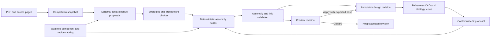

# Tachyon — Technical Specification

Implements the [approved PRD](prd.md) and [approved scope](scope.md). The learner
approved scoring reach/height as the first genuine assembly edit and requested
staged acceptance rather than making all 44 criteria prerequisites for the first
working version. Fast build mode remains selected. This is a proposed technical
blueprint, not an implementation or verification record.

**Approval readiness:** the architecture, contracts, edit behavior, and build
sequence are defined below. A complete permission-qualified CAD component set
has not yet been established; the source/recipe qualification item in **Decisions
and Open Issues** is an explicit blocker to finalizing this spec. Do not infer
that a public download, a software license, or a source URL resolves asset rights.

## How This Works, In Plain Language

The browser is the design workspace. A small Python application reads the
competition PDF, keeps page references, and asks an AI model for strategies and
two robot architecture proposals. The AI chooses from the mechanisms Tachyon
actually supports. New deterministic assembly code places real imported parts
using their mounting interfaces; the model does not invent arbitrary meshes or
execute CAD code.

The browser receives a complete assembly description plus reusable component
meshes. That same description names the mechanisms used by each strategy step.
Clicking a step highlights those components and derives a matching sketch and
field view. A supported height request selects another qualified configuration
and builds a complete candidate assembly. Preview displays that candidate; Apply
accepts it, Discard abandons it, and Undo restores the previous assembly content.

Use one local Python service, one local database, and one external model provider.
The frontend development server is a development convenience; a built application
can be served by the Python service. There is no agent framework, vector database,
distributed job system, Fusion dependency, or physics service in the critical path.

## Essential Demo and Acceptance Priorities

Implements `prd.md > The Core Journey`, `What We're Building > Acceptance
Demonstration`, and the learner's post-approval staging clarification.

### V1 — First Working End-to-End Version

1. Open Home in a mobile-first full-screen workspace. Default Override has a
   pinned competition snapshot with inspectable sources. Both Generate Strategy
   and Create Robot enter the same underlying generation services independently.
2. Make a real model call for grounded strategies and two different supported
   architecture recipes. Build two connected, inspectable conceptual robots from
   qualified authentic components; inspect their mechanical differences.
3. Open design A, select its scoring action, and highlight the actual scoring
   subsystem. Show a concise derived sketch and schematic field step.
4. Ask the top-left core to increase scoring height/reach to a supported
   configuration. Inspect the candidate geometry and assembly diff; Apply;
   select the same strategy step and verify the new mechanism binding; Undo.
5. Repeat the preview and Discard it. Verify the accepted assembly is unchanged.
   Try an unsupported change and receive an honest unsupported result.
6. Show both SNAP and SHIFT, the core's compact/expanded/full-screen states,
   and usable phone orbit/zoom, selection, panel dismissal, and command entry.

This is a real application milestone. A UI shell, static robot, recorded model
response, placeholder geometry, or partial drivetrain does not count as V1.
It is also not a claim that all PRD acceptance checks have passed.

### P0, P1, and P2 Gates

- **P0:** the essential live demo and the invariants that make its CAD, AI edits,
  and strategy links truthful. Required before calling V1 working.
- **P1:** complete the remaining core workflow cases, second-rulebook support,
  inspection/motion, persistence, and wider mobile/accessibility verification.
- **P2:** complete advanced inspection/display and layout breadth. Still part of
  the approved POC; it does not block V1. Do not call the full POC complete until
  its required criteria have been verified or a change is explicitly agreed.

| PRD criterion | Gate | First-version boundary or later completion |
| --- | --- | --- |
| COMP-1 | P0 | Pinned default and source/version inspection |
| COMP-2 | P1 | Another supported PDF through the same ingestion/model pipeline |
| COMP-3 | P1 | Full document-error matrix; P0 still rejects missing/invalid essential facts |
| COMP-4 | P1 | Competition switching and late-result isolation |
| STRAT-1 | P0 | Standalone live generation of distinct approaches |
| STRAT-2 | P0 | Grounded objectives, mechanism needs, sequence, rationale, sources |
| STRAT-3 | P1 | Full strategy-to-robot handoff and navigation continuity |
| STRAT-4 | P1 | Complete cancellation/retry cases; P0 forbids fabricated model success |
| ROBOT-1 | P0 | Direct rule-based Create Robot without prior Strategy screen |
| ROBOT-2 | P0 | Two mechanically distinct supported architectures |
| ROBOT-3 | P0 | Two complete connected conceptual assemblies |
| ROBOT-4 | P1 | Full comparison/view-context retention; basic A/B inspection is P0 |
| ROBOT-5 | P1 | Partial-result recovery and candidate-specific retries |
| CAD-1 | P0 | Real detailed component identity, dimensions, provenance |
| CAD-2 | P0 | Connected hierarchy, mounts, actuation paths, joints |
| CAD-3 | P0 | Incomplete/conceptual/invalid geometry cannot pass readiness |
| CAD-4 | P0 | Qualified rights/attribution and accurate mesh/solid claims |
| VIEW-1 | P0 | Desktop and phone orbit/zoom/pan/select/reset |
| VIEW-2 | P1 | Complete hierarchy-to-canvas selection equivalence |
| VIEW-3 | P2 | Full hide/isolate/explode/orientation/display matrix |
| VIEW-4 | P1 | Supported joint-operation controls and limits |
| VIEW-5 | P0 | CAD is the workspace; dismiss/reopen panels without reset |
| LINK-1 | P0 | Step highlights its real mechanism with explanation/sketch/playbook |
| LINK-2 | P1 | Complete reverse mechanism-to-actions navigation |
| LINK-3 | P1 | All sketch/operation/field assumption cases |
| LINK-4 | P0 | Link and illustration validity after an accepted edit and Undo |
| AI-1 | P0 | Three assistant states, internal controls, both themes |
| AI-2 | P0 | Selection-aware target handling; honest ambiguity/unsupported responses |
| AI-3 | P0 | Genuine assembly preview and accepted revision change |
| AI-4 | P0 | Apply/Discard/Undo consistency and safe failed edit handling |
| AI-5 | P0 | Demonstrated qualified scoring-height/reach edit |
| THEME-1 | P0 | Both visual/interaction identities and core motion |
| THEME-2 | P1 | Full theme-switch continuity matrix; engineering data is immutable in P0 |
| THEME-3 | P1 | Full motion audit; basic reduced-motion support ships with P0 styling |
| LAYOUT-1 | P1 | Full Simple/Advanced detail; both mode controls and basic progressive detail start in P0 |
| LAYOUT-2 | P2 | Split/Studio/Custom resizing/maximize/restore breadth |
| LAYOUT-3 | P1 | Full adaptive-layout matrix; phone one-sheet focus is a P0 invariant |
| LAYOUT-4 | P1 | Retained theme/mode/layout preferences |
| MOBILE-1 | P1 | Full device/orientation journey; actual phone CAD/edit path is P0 |
| MOBILE-2 | P1 | Keyboard/orientation and all temporary-view continuity cases |
| MOBILE-3 | P1 | Wider touch/keyboard/focus audit; named reachable essential controls are P0 |
| STATE-1 | P1 | Resume/save-failure recovery across sessions |
| STATE-2 | P0 | Accepted/preview/incomplete/failed states stay distinguishable |
| STATE-3 | P0 | No simulated successful edits or enabled unavailable integrations |

No stage may waive authentic geometry, required assembly connections, revision
ownership, source binding, truthful availability, or accepted-state protection.
A partially covered P1 criterion is recorded as partial, not passed in full.

## The Core Journey Through the System

Implements `prd.md > The Core Journey` and F1–F7.



1. Document ingestion stores the PDF hash and page text. A structured extraction
   call proposes facts with exact page/excerpt references. Semantic validation
   rejects nonexistent pages, unsupported numbers, and missing required facts.
2. The strategy request includes the chosen competition snapshot and available
   recipe capabilities. The AI returns two approaches and recipe selections;
   validation checks cited facts, supported operations, and structural distinctness.
3. Assembly builders resolve component definitions, mate declared ports, populate
   subsystem/connection/joint records, and calculate reachable scoring poses from
   their actual geometry. Only validated complete candidates become ready.
4. The renderer loads content-addressed component GLBs and places instances from
   the revision. Selection uses stable semantic IDs; strategy and illustrations
   resolve through the same revision's action/mechanism links.
5. The assistant translates a bounded request into an allowed command. The
   builder creates a new candidate and rederives dependent artifacts. Preview
   and accepted state are distinct; Apply and Undo use atomic revision updates.

## Stack

These are recommendations for learner approval, grounded in the stated
React/TypeScript/Three.js direction and Python experience. They are not attributed
to an earlier user choice of exact package versions.

| Layer | Proposed choice | Reason and documentation |
| --- | --- | --- |
| Browser | React 19, TypeScript, stable React Three Fiber 9, Three.js, Drei controls | Product UI and semantic CAD scene in one application; R3F 9 pairs with React 19. Avoid R3F 10 alpha. [R3F](https://r3f.docs.pmnd.rs/getting-started/introduction), [React](https://react.dev/), [Three](https://threejs.org/docs/), [Drei](https://drei.docs.pmnd.rs/) |
| Frontend tooling | Vite, npm lockfile; plain CSS custom properties and component styles | Small build, no separate design-system/framework dependency. [Vite](https://vite.dev/guide/), [TypeScript](https://www.typescriptlang.org/docs/) |
| Shared browser context | React reducers/context; isolate CAD camera/animation updates from form rendering | Selection, active revision, and panel intent share one authority; no extra global-state package required |
| API | Python 3.12, FastAPI, Uvicorn, Pydantic 2 | Typed contracts and reuse of Python CAD ecosystem without another engineering service. [FastAPI](https://fastapi.tiangolo.com/), [Pydantic](https://docs.pydantic.dev/latest/), [Uvicorn](https://www.uvicorn.org/) |
| PDF | pypdf 6.x | Page-level text extraction without an OCR service. Scanned-only documents are explicitly unsupported initially. [Extraction](https://pypdf.readthedocs.io/en/stable/user/extract-text.html), [license](https://github.com/py-pdf/pypdf/blob/main/LICENSE) |
| CAD preprocessing | CadQuery/OCCT, NumPy; import STEP and export source-derived GLB | Supports a small validated component catalog and geometric inspection. No runtime Fusion dependency. [Installation](https://cadquery.readthedocs.io/en/latest/installation.html), [import/export](https://cadquery.readthedocs.io/en/latest/importexport.html) |
| Persistence | Python sqlite3 plus local content-addressed files | Atomic accepted-revision changes and reproducible assets without a hosted database. [sqlite3](https://docs.python.org/3.12/library/sqlite3.html) |
| AI | One server-side provider adapter; recommend OpenAI Responses with strict structured output, configurable model | No multi-agent orchestration; deterministic code validates and executes proposals. [Structured outputs](https://developers.openai.com/api/docs/guides/structured-outputs?api-mode=responses), [Responses](https://developers.openai.com/api/reference/resources/responses/methods/create) |
| Verification | pytest, Vitest/Testing Library, Playwright | Engineering/revision checks, component behavior, and actual browser CAD journeys. [pytest](https://docs.pytest.org/), [Vitest](https://vitest.dev/guide/), [Testing Library](https://testing-library.com/docs/react-testing-library/intro/), [Playwright](https://playwright.dev/docs/test-projects) |

Pin resolved exact packages and CAD converter versions in lockfiles during the
approved build; do not claim dependency compatibility has been tested now. The
workspace currently exposes Node 24.6.0 and an explicit Python 3.12 interpreter;
default `python3` is 3.14.3. Create Tachyon's own 3.12 environment for CAD packages
rather than assuming the default interpreter is appropriate or using another
project's environment. Source meshes and their applicable rights are separate
from CAD software licenses.

## Where It Runs and How Someone Tries It

Proposed default: a local-first web application for one person, with server-side
AI credentials. The laptop runs the Python application; desktop or a phone on
the same trusted network opens its web interface. Remote hosting is optional
and not required to record the demonstration. No accounts, payments, cloud CAD
API, or cross-device synchronization service are required.

**Planned commands — not executable project instructions yet.** These files and
entry points will be created only after `4-spec` approval:

```sh
python3.12 -m venv .venv
source .venv/bin/activate
python -m pip install -r server/requirements.lock
python -m pip install --no-deps -e ./server
npm ci --prefix web
python -m tachyon.cli assets-prepare --manifest data/catalog/manifest.json
TACHYON_UI_ORIGIN=http://127.0.0.1:5173 python -m uvicorn tachyon.app:app --host 127.0.0.1 --port 8000
```

In a second terminal, `npm run dev --prefix web -- --host 127.0.0.1` serves the
development UI at `http://127.0.0.1:5173`. Open the authorized launch URL printed
by the serving Python process for that UI origin; Vite proxies `/api`, document,
and asset requests to Python. For a recording or phone test, build with
`npm run build --prefix web` and run Uvicorn with `--host 0.0.0.0 --port 8000`;
the server serves `web/dist`. Set `TACHYON_UI_ORIGIN` to the laptop's actual LAN
origin at port 8000 and open the serving process's printed authorized launch URL
on the phone. Same-origin serving avoids a second exposed phone-facing API port.

LAN mode uses a process-local owner session token and Origin checks; the server
remains loopback-only by default. The serving app's startup/lifespan creates the
token in that same process and prints an owner-console launch URL for
`TACHYON_UI_ORIGIN` with the token in its fragment. The asset-preparation CLI does
not create this token. The browser removes that
fragment immediately, keeps the token in tab session storage, and sends it in
`X-Tachyon-Session` on API/document/mesh requests. This is a local workspace token,
not the model-provider credential; exclude it from request/persisted logs and
recordings, including the owner-console launch message. The
loopback developer launch uses the same token mechanism. Fetch protected
meshes/PDFs through the API client, then use browser blob URLs for loaders/viewers.
Static UI and redacted health state may be public; other API responses require
the owner session. No account or pairing service is introduced. Store no model-
provider credential in a frontend variable, bundle, URL, or browser storage.
Put a secret-free `.env.example` in the repository and keep actual values local.
Only relevant competition excerpts and command context go to the AI provider.

Planned server configuration names: `TACHYON_AI_PROVIDER=openai`,
`TACHYON_AI_MODEL=gpt-6-astra`, `OPENAI_API_KEY` (private server credential), and
`TACHYON_DATA_DIR=.local`, and `TACHYON_UI_ORIGIN` (the permitted UI origin).
Configuration resolves data paths within this project's workspace. Only the
serving process owns the ephemeral session token, and restarting it invalidates
old session tokens; the client preserves local input and requests a new launch
URL instead of claiming a successful mutation. Explicit
changes to provider/model remain visible and are not a silent fallback.

Setup must identify permitted asset acquisition, source hashes, conversion, and
license/attribution conditions. If rights do not permit bundling, document the
authorized acquisition route and keep assets excluded. That does not itself
resolve usage/conversion/demo rights. An unavailable qualified catalog produces
an honest missing-assets startup state; it is not a successful CAD demo.

Shipping still requires a public code repository and working demonstration
video. Deployment and publishing require separate authorization; no public
service, repository, or submission is created by this spec.

## Look and Feel

Implements `prd.md > Look and Feel`, F8–F10, and S4/S5.

Use CSS tokens for surfaces, text, borders, focus/selection, and restrained
accents. SNAP uses warm off-white/graphite/metallic gray and restrained
yellow/blue/red; SHIFT uses gunmetal/titanium, electric blue, and subtle copper.
Choose a readable system sans-serif initially; dimensions and part identifiers
use tabular numerals. This avoids a font-download dependency while preserving
the professional character. Keep component material identity separate from UI
theme tokens; highlighting is a reversible presentation overlay.

Build the core as small original SVG/CSS UI geometry, separate from robot CAD.
SNAP modules join briefly; SHIFT shell segments unfold. Respect reduced motion
for core, panels, camera transitions, and joint previews. Motion is triggered by
real interaction/operation state, not a fake progress animation.

The R3F canvas is the full-viewport base. DOM overlays provide a top-left core,
small design/revision context, reachable tools, and a single selection inspector.
Phone expanded panels use one resizable sheet with its own scroll/drag region;
CAD gestures stay in the canvas region. Desktop panels may dock, resize, and
maximize as P1/P2 functionality arrives. All three assistant modes have their
controls inside the assistant. Basic SNAP/SHIFT, Focus, core states, phone input,
and dismiss/reopen work are part of P0, not deferred decorative work.

## Components

Each heading is an implementation address for the later `5-build` checklist.
All application modules are newly authored for Tachyon; only separately licensed
public dependencies/assets are incorporated with provenance.

### Competition Ingestion and Grounding

Implements `prd.md > F1 — Competition Selection and Rulebook Review` and F2.

`competition/ingest.py` stores a PDF by hash and extracts each page with pypdf.
`competition/grounding.py` accepts structured candidate facts only when their
document/page/excerpt exists, units are explicit, and a numeric value is supported
by the cited text. AI interpretation stays separate from source fact fields.
Missing essential robot constraints or task dimensions remain unknown; no
universal legality engine is implied. Ignore document instructions as untrusted
content; documents cannot select tools, files, secrets, or system instructions.

Default Override is a versioned, sourced snapshot and PDF identity, not a set of
unattributed hardcoded game rules. Reuse the same schema/ingestion service for
the additional PDF. Propose the official historical **Push Back v4.0** PDF as
the P1 second-rulebook test; it exercises different objects/scoring, not a renamed
Override snapshot. Additional-game strategy extraction does not imply a complete
new mechanical recipe exists for that game; report capability limits accurately.

### Strategy and Architecture Proposals

Implements F2 and F3.

`strategy/generate.py` sends the competition snapshot, cited facts, user priorities,
and qualified recipe capabilities to the provider. Output contains exactly two
candidate strategies/architecture proposals for the demo. The server validates
all fact/action references and requires different architecture signatures.
The model may choose only registered recipes/configurations; arbitrary generated
Python, mesh paths, part URLs, part scales, and shell instructions are rejected.

A signature records lift family, acquisition/retention family, drivetrain
configuration, and major subsystem arrangement. Color, wording, camera, and
small coordinate changes do not establish a second architecture. A template is
an executable assembly recipe, not a prebuilt robot passed off as AI CAD synthesis:
the AI's grounded requirements choose the recipe/configuration and the new
builder resolves and assembles its actual parts. Record this generation method
truthfully in the interface and README.

### Authentic Component Catalog and Mesh Preparation

Implements F4 and CAD-1–4. This is a **P0 qualification gate**.

`cad/catalog.py` reads a versioned manifest of actual source CAD, rights evidence,
component identity, units, dimensions, and manually verified connection ports.
`cad/prepare.py` imports qualified STEP with CadQuery, checks solids/bounds, and
exports each component's source-derived GLB with named child geometry and a
conversion receipt. CadQuery supports STEP input and assembly GLB export; a
one-component assembly can supply a reusable display asset. Preserve the source
solid and never call the resulting browser mesh an editable parametric solid.

Normalize source units once into **metres**. Document the source-to-browser axis
transform; use right-handed Y-up in browser/assembly records. Native asset frames
are converted once, then instances use only translation and unit quaternions.
Do not nonuniformly scale parts to create a desired channel, shaft, or mechanism.
Use a real alternate SKU/stock length or a documented permitted manufacturing
operation with a new identity and source receipt.

Each accepted part needs `sourceSha256`, `meshSha256`, converter/version/settings,
unit conversion, source selection, and verified interfaces. A label saying
authentic is insufficient: check bytes, component identity/dimensions, geometry,
and rights evidence. Shared meshes may be reused across many instances without
duplicating triangles. No entire unreviewed library needs to be bundled.

### Assembly Recipes, Connections, and Validation

Implements F3/F4/F5. Proposed bounded Override recipe families for source and
engineering qualification are:

| Recipe | Functional difference | Required sourced assemblies |
| --- | --- | --- |
| `four_bar_gripper` | Parallel-link lifting/scoring geometry with a supported retaining end effector | Chassis/drive, braced four-bar with pivots/bearings, powered transmission, retention/gripper, control/power mounting |
| `elevator_gripper` | Vertically guided carriage and retention/scoring stage, mechanically distinct from the four-bar | Chassis/drive, tower/guides/carriage, complete supported lift transmission, retention/gripper, control/power mounting |

These are proposals, not qualified robots or claims that the necessary CAD has
been found. Source/port/clearance feasibility must qualify both, or the affected
recipe choice must return to review. Do not replace a missing elevator with
floating geometry or count two copies of the four-bar as two architectures.
The drivetrain follows each recipe's requirements; use supported transmissions
and available source parts rather than an unexplained four-motor direct-drive
default. Do not promise an unsupported gear/chain configuration.

`assembly/builders.py` resolves components by catalog role and mates verified
ports. For fixed mates, solve the child transform from parent world transform,
parent port frame, allowed mate transform, and inverse child port frame. Revolute
or prismatic joints add their declared axis/origin/limits and moving members.
The graph includes hardware, supporting mounts, shaft engagement, and actuator
paths; it is not a scene graph with merely adjacent meshes.

`MechanismCapability` is a revision-scoped contract, not a descriptive label.
It names the mechanism, actual members/joints/actuator paths, sourced object
interface (dimensions/orientation/allowed contact), supported acquisition and
retention configuration, scoring target frames, usable pose/reach envelope,
and relevant clearance evidence or unknowns. `ActionRequirement` names those
needs and their competition/source references. Qualification maps every required
action to a capability with compatible object interface, target pose, reach,
and supporting hardware. A connected gripper alone does not establish that it
can acquire or retain the game's object. Geometry-supported conceptual task
compatibility is distinct from a physically executed/validated handling cycle;
unknown essential task support keeps the recipe incomplete.

`assembly/validate.py` checks referential integrity, rigid transforms, units,
source availability, root connectivity, no unattached required subsystem, valid
port types/alignment, joint members/limits, supported drive paths, and configured
envelope/clearance requirements. Source-based tolerances are recorded with their
basis. Required interfaces with unknown facts do not pass by default. Broad-phase
bounds and recipe-specific non-mating interference checks supplement port checks;
known mating contact is not an excuse to ignore unrelated interpenetration.
Sampled motion checks are labeled sampled, not continuous collision certification.
No physics simulation or measured scoring success is implied.

For P1 operation controls, use bounded recipe-specific `pose(q)` functions,
not a general constraint solver. A qualified parallelogram four-bar couples its
links and carrier frames analytically and checks all loop-closure port errors.
The elevator derives carriage translation and coupled drive/transmission motion
from sourced pitch/radius/connection data. Define dependent member transforms
and validate shown poses against declared limits and closure. Unknown coupling
data or unsupported loop geometry disables the operation; independent rotations
that break a four-bar cannot count as animation. These controls do not gate V1,
but real static task/mount relationships do.

### Scoring Configuration Edit and Revision Service

Implements `prd.md > F7 — Contextual AI Core and Real Design Changes` and LINK-4.

Expose one engineering command initially:

```text
set_scoring_configuration(
  designId, baseRevisionId, mechanismId,
  configurationId = one of the qualified recipe's registered configurations
)
```

For V1, one qualified demonstration recipe has `standard` and `raised`
configurations; the other complete architecture needs a qualified baseline.
There is no requirement to qualify four assembly variants before showing V1.
Capabilities expose the height edit only on the qualified editable design;
extending it to another recipe is later coverage, not implied support.
The configuration manifest specifies actual part variants or mounting-port choices,
required supporting parts/fasteners, changed placements/connections/joint frames,
joint limits, and the measured/recomputed scoring envelope. A taller request
selects the next registered configuration only if that configuration is valid
for the selected design and competition requirements. An arbitrary requested
height outside the registered range is unsupported or needs clarification.

The raised configuration must change engineering assembly data and demonstrate
a corresponding geometry/reach difference. Changing a camera, display explode
offset, material, mesh scale, joint pose alone, or text description cannot pass.
Do not invent numeric heights before source parts/ports are measured. Both
demonstration-recipe configurations need source identities and a known delta in
supported scoring reach/height before the edit can be declared available.

`revisions/service.py` owns the transaction:

1. Read the accepted base revision and selected mechanism's current registered
   configuration. Reject another design's selection or a stale base.
2. Resolve the requested allowed configuration, rebuild the affected assembly
   and necessary supports, then run assembly and relationship validation.
3. Derive new action bindings, reach/capability facts, mechanical explanations,
   sketch/playbook anchors, and operation availability from the candidate.
   Invalidate prior configuration-dependent claims/tradeoffs; regenerate them
   from candidate facts or mark nonessential prose pending. Required action
   support and links must be valid before Apply. Store the candidate snapshot,
   diff, source/catalog fingerprints, and validation with its base revision.
4. Preview renders **that stored candidate**. It does not alter the accepted
   pointer. Invalid candidates expose blockers and cannot be applied.
5. Apply rechecks the current base, source/catalog identity, and validation;
   atomically accepts the revision using the ID/content reserved by the preview.
   Push the previous accepted state onto this design's undo stack. Do not
   regenerate a different robot or change the previewed engineering content.
6. Discard closes the proposal and restores display of the accepted snapshot;
   the accepted engineering state was never mutated.
7. Undo pops this design's latest accepted-change undo entry and atomically
   creates a compensating revision with that engineering content and regenerated
   revision-scoped bindings/explanations. Do not push the compensation as a new
   undoable edit; repeated Undo walks earlier edits instead of redoing the last
   one. Keep history and compare engineering hashes, not timestamps/new IDs.
   Empty Undo is unavailable. No destructive rollback.

Apply uses an idempotency key and optimistic concurrency (`expectedRevisionId`).
A second click returns the prior outcome. A concurrent edit, changed catalog,
or invalid link returns an explicit conflict/blocker; no partially updated
geometry, action links, or accepted pointer may remain.

Hash boundaries are explicit: `engineeringHash` covers canonical components,
transforms, connections, joints, configuration, and relevant source/context
identities; it excludes revision IDs, timestamps, and view state. `bindingsHash`
covers semantic links/capabilities/dependencies without its own hash or revision
tag. Candidate/accepted snapshot IDs are assigned before dependent artifacts are
derived. Whole-snapshot hashes exclude their own hash field; no artifact hash
recursively includes itself. Undo can restore the engineering hash while keeping
new revision/history identity.

### Strategy Binding and Derived Illustrations

Implements F6 and LINK-1–4.

`strategy/bindings.py` produces revision-scoped links from action → mechanism →
component instances/joints. Validate every ID and required capability in the
same revision. A mechanism's semantic ID can stay stable across configurations,
but its component membership, joint frames, reach, and evidence are rederived.
An old revision's link result is rejected against a new revision.

Keep strategic intent/cited rule text separate from design-dependent mechanical
claims and explanations. Each `DerivedExplanation`/mechanical claim names its
revision, mechanism, evidence keys, and engineering/bindings dependencies.
Render reach/height and supported operation statements from actual candidate
capabilities rather than stale free-form numeric prose. After Apply or Undo,
rederive them or visibly mark nonessential explanation text pending. Do not keep
the prior configuration's asserted reach/advantage as current. AI-generated
strategic intent may persist, but old mechanical claims cannot inherit supported
status merely because their component IDs still exist.

`illustrations/derive.py` emits declarative sketch and playbook data from the
selected action, actual interface/joint anchors, and sourced/assumed field
coordinates. The browser renders original SVG annotations and arrows. Use a
rough mechanical style without independent AI images inventing different parts.
Each artifact records its `revisionId`, `bindingsHash`, and dependency IDs.
Recompute affected artifacts or mark them pending; never retain a stale supported
action/sketch after Apply or Undo. Schematic field routes are labeled illustrative.

### CAD Renderer and Shared Selection

Implements F5/F6/F10 and S4.

`viewer/AssemblyScene.tsx` places catalog meshes using only the active accepted
or preview snapshot. Reuse geometry buffers; instance repeated parts when it
does not break picking. A mapping from rendered object/instance to component ID
supports picking, hierarchy selection, highlighting, hide/isolate, and camera
focus. All features use `Selection {revisionId, mechanismId?, componentId?,
actionId?}`; do not maintain disconnected selection states per panel.

Use orbit controls with distinct tap/drag behavior, pinch zoom, two-finger pan,
and explicit reset/focus actions. Keep view-only explode/visibility/camera state
separate from engineering transforms. Use demand-driven rendering when idle,
bounded device pixel ratio, shared meshes, and loading/error boundaries on phones.
Choose measured optimization thresholds during the build rather than promising
unverified FPS or discarding source detail into crude shapes.

### Workspace Shell, Themes, Assistant, and Layouts

Implements S1–S5 and F7–F10.

`WorkspaceShell` owns active design/revision, selection, requested panel, theme,
mode, and layout. `AiCore` owns compact/expanded/full-screen presentation and
command draft but consumes the shared selection. The server returns one of
`explanation`, `view_command`, `clarification`, `unsupported`, or `edit_proposal`.
Only a successful revision operation may cause an engineering-success message.

SNAP/SHIFT and the top-left core are P0 components, with original theme-specific
SVG/CSS motion and `prefers-reduced-motion` support. The phone panel coordinator
allows one expanded content sheet, preserves prior context, and leaves the CAD
interactive above the sheet. Full-screen assistant is intentional; collapse
restores the prior view. Simple/Advanced differ in exposure, not validation.
Add P1/P2 layout controls to the same shell; do not redesign the application into
a permanent dashboard or full-height default chatbot.

### Persistence, Operations, and Availability

Implements F11 and `prd.md > States and Boundaries`.

Store accepted state before reporting save success. SQLite holds document,
workspace, revision, and operation records; PDFs/meshes reside in a hash-addressed
local file store. Preferences may be cached in the browser but accepted assembly
state is server-authoritative. Source/version identity travels with every job.

An in-process bounded task runner executes AI/ingestion/generation operations
and reports actual stages through polling. Restarted unfinished operations become
interrupted/failed rather than magically complete. Cancellation prevents later
publication of a result even when an already submitted provider call cannot be
stopped. Do not add Redis, Celery, web sockets, or multiple worker services for
the POC. Preserve the prior accepted design on any generation/edit failure.

`GET /api/capabilities` derives enabled recipes/configurations/integrations from
qualified available resources. A missing asset/key/recipe yields a specific
unavailable reason. Fusion, voice, external editing, and simulation are absent
or visibly unavailable until genuinely implemented; there is no success stub.

## Data Model

All server records are Pydantic models with schema versions, strict enums, and
finite numeric values. JSON snapshots are authoritative and immutable once
accepted. The frontend consumes these contracts; shared representative contract
fixtures catch drift between TypeScript and server validation.

| Record | Essential fields and relationships | Lifetime/storage |
| --- | --- | --- |
| `SourceDocument` | ID, URL/user upload, content hash, media type, page count, page texts, source/version/license reference | `documents` metadata; PDF/page artifacts by hash |
| `FactRef` / `CompetitionSnapshot` | Document hash, one-based page, section, exact excerpt; fact value/unit/status; objectives, scoring actions, constraints, field anchors/assumptions | Immutable snapshot inside document/workspace JSON; new source version means new snapshot |
| `StrategySet` | Competition snapshot ID/hash, provider receipt, two strategies with objectives/actions, citations, requirements, recipe choices, tradeoffs | Workspace JSON; never relabeled for another competition |
| `ActionRequirement` / `MechanismCapability` | Revision/action/mechanism identity, sourced object interface, acquisition/retention needs, scoring target frames, reach/pose envelope, hardware and clearance evidence, support/unknown status | Candidate/accepted revision; compatibility required for every required action |
| `ComponentDefinition` | Source/mesh identity, SKU or qualified identity, geometry class, unit/frame conversion, dimensions, solids, material display data, interfaces, rights evidence | Versioned catalog plus qualified local asset cache |
| `InterfacePort` | Component-local frame, kind, size/shaft/mount properties, allowed mating types, tolerance and evidence | Catalog definition; manually verified from actual source |
| `AssemblySnapshot` | Catalog/recipe/configuration versions; component instances; subsystems; connections; joints; actuation paths; completeness/evidence report | Immutable `revisions` JSON; instances reference shared definitions |
| `ComponentInstance` | Stable ID, definition ID, subsystem, rigid translation/quaternion, parent/joint group, provenance reference | Inside its assembly revision; no arbitrary per-instance scaling |
| `Connection` / `Joint` | Interface endpoints, fastening/drive/support relation and members; joint origin/axis/type/limits/moving IDs, couplings, recipe pose-function identity and loop-closure constraints | Same revision; all referenced IDs must exist; unsupported motion stays disabled |
| `ActionBinding` | Competition/strategy/action IDs, mechanism ID, component/joint IDs, supported/unsupported status and reason, revision/bindings hashes | Derived and stored with each candidate/accepted revision |
| `IllustrationSpec` | Action, revision, source and actual mechanism anchors, annotations, dependency hash, schematic/assumption labels | Derived per revision; invalidated with dependencies |
| `DerivedExplanation` | Revision, mechanical claim/evidence keys, mechanism ID, engineering/bindings dependencies, current/pending/unsupported status | Revision-scoped derived content; stale configuration prose cannot remain current |
| `DesignRevision` | Design ID, parent/history reference, immutable assembly + strategy links/artifacts, content/engineering hashes, validation report | `revisions`; workspace stores accepted revision pointer per candidate |
| `EditProposal` | Design/expected-base IDs, command/configuration, candidate revision/hash, diff, validation/blockers, status | `operations` JSON; pending → applied/discarded/failed/conflicted |
| `CandidateOutcome` / `Operation` | Workspace/competition/request identity, candidate slot and attempt, per-candidate ready/failed/incomplete status and result/blockers, provider request/usage metadata, cancel/interrupted state | `operations`; mixed outcomes can be partial; no provider key or hidden reasoning stored |
| `Workspace` | Competition/strategy references, two design IDs and accepted pointers, per-design undo stacks, selected context, preferences, save version | `workspaces`; pointer/undo updates share one transaction; stale saves are rejected |

Only four SQLite tables are initially needed: `documents`, `workspaces`,
`revisions`, and `operations`. JSON stores the typed internal records; explicit
IDs/version fields support lookups and transactional pointer changes. No account,
sharing, billing, or generalized entity framework is introduced.

### Geometry and Rights Classification

Required fields are separate, not a single ambiguous `authentic` boolean:

```text
originKind: manufacturer_cad | community_component_model | tachyon_authored
geometryClass: verified_imported_component | conceptual | placeholder | test_fixture
rightsStatus: qualified_for_declared_use | unverified | disallowed
sourceIdentity: source URL/revision + SHA-256 + actual component identity
conversionIdentity: tool/version/settings + output SHA-256 + units/frames
```

Manufacturer identity is not inferred for community CAD. A community component
model requires identity/dimension/detail validation and applicable rights; a
publisher's claim alone is not a manufacturer's certification. Conceptual field
markers, sketches, selection outlines, and the decorative AI core are acceptable
presentation elements; they cannot satisfy required mechanical components.

A complete authentic-CAD acceptance run requires zero placeholder/test/conceptual
instances in required robot hardware, all required source assets present, rights
qualified for the declared use, and connected inspectable assemblies. Pure unit
tests may use named synthetic fixtures, but they never count as CAD/demo evidence.

## Interfaces Between Components

### Internal Service Contracts

| Producer → consumer | Contract | Reject condition |
| --- | --- | --- |
| Ingest → grounding | Hashed document + ordered page text | Unreadable/missing essential content |
| Grounding → strategy | Versioned competition facts with citations and unknowns | Unsupported factual claim or missing critical constraint |
| Catalog → proposals/builder | Qualified parts, recipes, ports, supported configurations/capabilities | Unknown/unqualified/missing required asset |
| AI → strategy/assistant service | Validated proposal/intent data only | Schema error, refusal, invented ID, unsupported recipe/command |
| Builder → validator | Whole candidate assembly + requested capabilities | Disconnected hardware, invalid rigid transforms/ports/paths |
| Validator → revision service | Candidate hash + evidence + derived bindings/artifact identities | Any mandatory check missing/failed or stale identity |
| Revision service → renderer | Exact accepted or candidate snapshot + mesh identities | Mismatched revision, missing bytes, wrong owning design |
| Selection → strategy/core | Revision-scoped semantic selection | Removed or stale component/action ID |

### HTTP API

All mutating requests carry the local session token; operation and revision
responses include their owning design/competition identity. Successful async
starts return `202 {operationId}`. Polling returns actual status/stage, origin,
result IDs or a typed error. No endpoint treats a model response as CAD success.
Generation operations also return per-slot `CandidateOutcome` entries. Terminal
status is `completed` only when both required candidates are ready, otherwise
`partial`/`failed` with blockers. A P1 candidate retry creates a new attempt bound
to the same workspace, competition snapshot, original request hash, and candidate
slot. It preserves the successful candidate and validates distinctness against
that candidate; an older attempt cannot overwrite a newer result.

| Method and path | Request → response |
| --- | --- |
| `GET /api/health` | Runtime/asset/provider availability, no secret values |
| `GET /api/capabilities` | Available recipes/configurations/commands and unavailable reasons |
| `GET /api/competitions` | Default/available versioned snapshots |
| `POST /api/competitions/import` | Multipart PDF → operation; result is document + snapshot or unsupported review state |
| `GET /api/competitions/{id}` | Snapshot/facts/source references |
| `GET /api/documents/{id}/pdf` | Authorized local PDF for cited page navigation |
| `POST /api/strategies` | `{workspaceId, competitionSnapshotId, priorities?}` → operation returning grounded strategies |
| `POST /api/designs/generate` | `{workspaceId, competitionSnapshotId, strategyId?, description?, priorities?}` → operation returning two candidate outcomes/design IDs |
| `POST /api/designs/generations/{id}/candidates/{slot}/retry` | P1: `{workspaceId, competitionSnapshotId, expectedRequestHash, idempotencyKey}` → targeted retry operation; preserve the other candidate |
| `GET /api/operations/{id}` | Status/stage/origin/result/error |
| `POST /api/operations/{id}/cancel` | Idempotent cancellation request/result |
| `GET /api/designs/{id}` | Accepted revision, strategy, supported configurations, readiness |
| `GET /api/revisions/{id}` | Immutable snapshot, bindings, illustrations, evidence |
| `GET /api/assets/{hash}.glb` | Qualified source-derived mesh; no arbitrary filesystem access |
| `POST /api/assistant` | `{designId, baseRevisionId, selection, text}` → operation returning explanation/view command/clarification/unsupported/proposal |
| `GET /api/proposals/{id}` | Base + exact candidate/diff/report/status for preview |
| `POST /api/proposals/{id}/apply` | `{expectedRevisionId, idempotencyKey}` → accepted revision or `409` conflict/validation blocker |
| `POST /api/proposals/{id}/discard` | Idempotently discard without changing accepted revision |
| `POST /api/designs/{id}/undo` | `{expectedRevisionId, idempotencyKey}` → new revision containing the prior engineering state |
| `PATCH /api/workspaces/{id}` | Valid preference/context fields with expected save version → persisted workspace |

Error body: `{code, message, retryable, operationId?, contextId?, details?}`.
Use meaningful errors such as `AI_UNAVAILABLE`, `UNSUPPORTED_CONFIGURATION`,
`SOURCE_NOT_QUALIFIED`, `ASSEMBLY_INCOMPLETE`, `STALE_REVISION`, or `BROKEN_BINDING`.
Do not return filesystem paths, credentials, or a success body for an unsupported
edit. Upload limits/timeouts and accepted MIME/signature checks are explicit
configuration, validated during the build.

## File Structure

Planned files, not currently implemented. Each directory has a specific role in
the preceding component headings; do not create placeholder modules to imply
completion. Keep build progress in the later Markdown checklist.

```text
Tachyon/
├── AGENTS.md
├── README.md                         # Verified setup/run and honest capability status
├── .env.example                      # Server-only placeholders
├── THIRD_PARTY_NOTICES.md
├── LICENSES/
├── .agents/skills/                    # Official curriculum, unchanged
├── devpost/
│   ├── scope.md                      # Approved
│   ├── prd.md                        # Approved, with staged technical acceptance
│   ├── spec.md                       # This draft; approval required
│   └── learner-profile.md            # Local, ignored
├── docs/
│   ├── product-vision.md
│   └── cad-source-status.md          # Public source/permission qualification status
├── data/
│   ├── competitions/                 # Versioned facts/source identities and notices
│   ├── catalog/manifest.json         # Qualified part/port/rights identities
│   └── recipes/                      # Four-bar/elevator definitions and configurations
├── server/
│   ├── pyproject.toml                # Tachyon package and locked dependency inputs
│   ├── requirements.lock
│   ├── tachyon/
│   │   ├── app.py                    # API, same-origin assets, session checks
│   │   ├── cli.py                    # Setup/asset preparation and validation
│   │   ├── models.py                 # Pydantic contracts
│   │   ├── config.py                 # Explicit local paths/server credentials
│   │   ├── store.py                  # Four-table SQLite transactions/file hashes
│   │   ├── operations.py             # In-process jobs and actual progress
│   │   ├── competition/{ingest,grounding}.py
│   │   ├── ai/{provider,openai_provider}.py
│   │   ├── strategy/{generate,bindings}.py
│   │   ├── cad/{catalog,prepare}.py
│   │   ├── assembly/{builders,validate}.py
│   │   ├── revisions/service.py
│   │   └── illustrations/derive.py
│   └── tests/                        # Assembly/link/edit/source/contract regressions
├── web/
│   ├── package.json
│   ├── package-lock.json
│   ├── index.html
│   ├── tsconfig.json
│   ├── vite.config.ts
│   ├── playwright.config.ts          # Browser tests in ../tests/e2e
│   └── src/
│       ├── main.tsx
│       ├── App.tsx
│       ├── api/{client,contracts}.ts
│       ├── workspace/{context,reducer}.tsx
│       ├── screens/{Home,Strategy,DesignCompare}.tsx
│       ├── viewer/{AssemblyScene,Selection,ViewControls}.tsx
│       ├── assistant/{AiCore,AssistantPanel,ChangePreview}.tsx
│       ├── panels/{StrategyPanel,ComponentsPanel,PanelHost}.tsx
│       ├── illustrations/{MechanismSketch,FieldPlaybook}.tsx
│       └── styles/{tokens,themes,workspace,motion}.css
├── tests/e2e/                        # Real browser CAD and lifecycle journeys
└── .local/                           # Ignored PDFs/assets/database/proposals/evidence
```

## External Services and Dependencies

### Model Provider

Recommend a single OpenAI adapter, pending the learner's provider preference.
Use `POST https://api.openai.com/v1/responses`, Bearer authentication from the
server, and a model named by `TACHYON_AI_MODEL`. The current official structured
output guide recommends `gpt-6-astra` for new projects; this is a proposed default,
not a claim about this account's access. Allow explicit configuration of another
verified compatible model, never a silent substitute.

Payload: `model`, `store: false`, developer instructions, supplied competition/
catalog/selection context as user data, and strict `text.format` JSON schema.
Schemas cover competition facts, two strategy/recipe proposals, and assistant
intent/proposal data. Validate the completed result again with Pydantic and
semantic source/catalog checks. Structured output constrains shape, not the
truth of engineering facts. Check refusal, incomplete output, timeout, `429`,
and provider errors explicitly. No arbitrary model tools mutate the assembly.

Store provider/model/request identity and returned usage for genuine inference
evidence. Do not log credentials or hidden reasoning. Respect provider rate-limit
responses and bound retries; cancellation prevents a late result from replacing
accepted work. Actual cost and account limits depend on model/account and are
not verified here. Consult the current [pricing](https://developers.openai.com/api/docs/pricing)
and [rate-limit guidance](https://developers.openai.com/api/docs/guides/rate-limits)
before the live build smoke test. A missing key remains unavailable; a static
fixture cannot substitute for the live AI acceptance demonstration.

### Competition Sources

The [official VEX competition page](https://www.vexrobotics.com/v5/competition)
links Override v2.1 and its official manual. The [versioned game section](https://manuals.vex.com/v5/override/v2.1/game/)
was checked for current game identity and objectives. During source preparation,
record the actual downloaded PDF URL/hash/version and page references; do not
derive precise field/mechanism dimensions from an unmeasured illustration.

The proposed P1 additional document is [Push Back v4.0](https://content.vexrobotics.com/docs/25-26/v5rc-push-back/docs/Push-Back-4.0.pdf).
It is a historical test source, not the current default. Verify the bytes,
extraction, and applicable source handling before treating the pipeline as tested.

### CAD Sources and Rights

Only public source research has been used in this technical plan. Findings and
links are recorded in [CAD source status](../docs/cad-source-status.md).
Manufacturer download access exists, but that alone is not a redistribution or
conversion permission. A public Fusion add-in repository has an MIT software
license; the complete required geometry's coverage has not been established.

No full CAD library has been imported or declared qualified. Final spec approval
requires an identified component set whose rights cover the planned acquisition,
conversion, local use/display, demonstration, and any intended distribution.
Record asset-specific restrictions/attributions separately from application
licensing. Do not ask the AI to invent a substitute or use a placeholder as the
solution to this dependency.

## Testing Strategy

Implements the PRD's 44 criteria according to the gate table, not as an
all-at-once first-version suite.

### P0 Engineering and Revision Tests

- Load actual qualified source bytes and compare component identity, units,
  dimensions, mesh/source hashes, and required geometry classes. Inspect the
  full assembly and close-up source detail; a boolean authenticity tag is not
  the acceptance oracle.
- Build both complete recipe baselines and the demonstrated recipe's raised
  configuration; check connected required hardware,
  mounts, shaft/actuation paths, interfaces, joints, and declared checks.
  Fault injection removes a required fastener/support, breaks a source hash,
  mismatches units, disconnects a subsystem, or inserts a placeholder; readiness
  must fail for the relevant reason.
- Compare standard versus raised assembly transforms/components/connections
  and measured scoring envelope. The difference must survive serialization and
  reopening; it cannot exist only in a render callback.
- Preview leaves the accepted engineering hash unchanged; Apply accepts the
  exact preview content; Discard preserves accepted content; Undo restores the
  preceding engineering hash and corresponding action/illustration bindings.
- Reject stale-base, duplicate-Apply, wrong-design selection, changed catalog,
  unsupported configuration, removed linked component, and invalid new capability.
- Reject missing task/object-interface/target-pose support even when every part
  is connected. After edits and repeated Undo, ensure no prior reach or operation
  claim remains current against the wrong revision; exercise dependency hashes
  and a stale explanation/illustration fault as well as stale component IDs.

### Browser and Live Demo Tests

Run actual Chromium/WebKit desktop and phone-sized journeys with real qualified
CAD assets. Inspect scene-loaded components and selection targets as well as
screenshots; a screenshot alone cannot prove revisions or bindings are correct.
Exercise the whole V1 path, genuine server model calls, Apply/Discard/Undo,
unsupported requests, both themes, the three assistant states, touch controls,
and panel dismissal. Verify a phone on the local network at least once; emulated
viewport checks do not prove every physical gesture or GPU works.

Use fake provider fixtures only for deterministic error/contract tests, clearly
identified as tests. The final live smoke test records real provider request
identity and actual geometry/revision changes without exposing secrets. No paid
live model call is made just to approve planning documents.

### P1/P2 Expansion

Add second-PDF parsing/grounding and source navigation, partial generation and
restart/cancellation cases, reverse links, sampled joint motion, saved context,
Simple/Advanced and theme continuity, and keyboard/phone-orientation coverage.
P2 completes display/explode/isolate and practical layout combinations. Run
targeted relevant checks after each slice; broaden only for new changes or failures.

Planned verification commands after implementation: `python -m pytest server/tests`,
`npm run test --prefix web -- --run`, `npm run build --prefix web`, and
`npm run test:e2e --prefix web`. Save actual results by milestone; no checks are
reported passed by writing this spec.

## Implementation Milestones

These milestones are the input to the future `5-build` checklist, not an approved
checklist and not authorization to start implementation now.

| Milestone | Deliverable and verification | Gate |
| --- | --- | --- |
| **M0 — Qualify inputs and bounded recipes** | Resolve CAD rights, actual component/port coverage for both complete baselines, and standard/raised configurations for the demonstration recipe. Map required tasks to sourced object interfaces/poses/reach/clearance evidence; record configuration differences, default source, and provider plan. | Required for final spec readiness; no claim of qualified CAD yet |
| **M1 — Runnable CAD foundation** | Own frontend/backend environment, typed snapshots, real qualified meshes, both connected builders, primitive rejection, full-screen mobile CAD, basic SNAP/SHIFT/core shell. Inspect actual geometry and run source/assembly regressions. | Verified internal increment; not yet the end-to-end V1 |
| **M2 — Competition and live generation** | Default cited competition, live grounded strategies, independent entry services, two distinctly generated recipe assemblies, real loading/errors. | P0 generation portion |
| **M3 — Linked inspection and supported edit** | Action/mechanism/sketch/playbook linkage; contextual core in three states; exact candidate Preview/Apply/Discard/Undo and rederived links; run live browser and phone path. | **V1** when every P0 obligation and invariant passes |
| **M4 — Complete P1 workflows** | Additional supported PDF, full handoff/retry/cancel/source/version isolation, reverse navigation/motion, persistence and wider mode/mobile/accessibility checks. | P1 |
| **M5 — Complete P2 and final review** | Inspection/display/layout breadth, remaining criteria, reproducible README/provenance, learner final review and learning wrap-up/app map. | Full approved POC; then `6-ship` |

Fast mode preserves a useful early hands-on review at V1 and final learner review.
Do not wait for P2 layout breadth before showing the genuine P0 path. If sources
or recipes fail qualification, resolve that issue or review the affected decision;
do not relabel a narrower fake result as completion.

## Important Failure Modes

| Failure | Required behavior |
| --- | --- |
| No qualified component set or conversion permission | Asset/recipe unavailable with exact missing evidence; no authentic/complete label and no primitive substitution |
| Invalid essential rule fact, model refusal, or unsupported recipe | Reject the affected proposal, retain useful source review and accepted designs; show a real failed/unsupported state |
| Invalid or stale candidate/link during Apply | Reject transaction; accepted pointer and visible accepted geometry remain unchanged |
| Provider delay/rate limit/restart/cancel | Actual operation status; bounded retry or interrupted state; late results cannot change a different context |
| GLB/GPU/loading failure | Show the specific asset/render problem and retain readable strategy/source content; do not display a synthetic success robot |
| Unsupported height, edit, or integration | Specific unsupported result; no changed engineering hash, success toast, or enabled fake external action |

## What Was Simplified and Why

- A curated component catalog and two deterministic recipe families keep AI
  grounded in mechanisms the application can actually assemble. This does not
  weaken authenticity or completeness requirements.
- One discrete engineering edit family proves the complete revision lifecycle;
  arbitrary natural-language CAD programming is outside the first build.
- Page-level source extraction and explicit unknowns avoid an OCR/retrieval
  service. More complex documents remain visibly unsupported initially.
- SVG sketches/field annotations derive from the same assembly/action data;
  a separate image-generation pipeline is unnecessary for coherence.
- One process, four SQLite tables, polling, and local files support the demo
  without accounts, a hosted database, distributed agents, or paid CAD APIs.
- P0/P1/P2 sequencing changes build order, not the approved full product vision.

## Decisions and Open Issues

### Established Decisions

The learner approved scope and PRD, confirmed authentic scoring reach/height
edits with real Preview/Apply/Discard/Undo, required correct post-edit strategy
bindings, preserved core UI/theme/mobile requirements, and explicitly allowed
staging the 44 criteria. No private engineering project, implementation, or
development artifact is a dependency of this application.

### Recommendations Awaiting Technical Approval

React/TypeScript/R3F plus a new small Python/FastAPI service; local-first running;
SQLite immutable revisions; one model-provider adapter; curated imported STEP
assets; deterministic four-bar/gripper and elevator/gripper recipes; discrete
standard/raised configurations; and the P0/P1/P2 gate assignments are proposed
here for review, not silently recorded as earlier learner-selected technologies.

### Useful Unknown Investigated

The learner specifically raised whether the height edit changes authentic
hardware and whether the 44 criteria would block the first runnable path. The
technical resolution is a whole candidate assembly revision from a registered
real-part configuration, with bindings/artifacts rederived before acceptance,
and an explicit staged criteria table. The source permission/geometry feasibility
part of that answer remains open; no learner uncertainty or learning accomplishment
is invented.

### Remaining Resolution Items

| Item | Current evidence/status | Required resolution |
| --- | --- | --- |
| **CAD permissions and complete component set** | Official/public candidate sources found; a full set with permission covering declared use and conversion is not established. A source question is pending. | **Blocks final spec approval/readiness.** Identify permitted source assets, rights coverage, actual ports/geometry, and configuration/component manifests for both complete recipes. No silent downgrade to primitives or incomplete CAD. |
| **Exact recipe configurations and task feasibility** | Four-bar/gripper and elevator/gripper are bounded proposals. Baseline task support and the demonstration recipe's standard/raised heights have not been qualified. | **Blocks final engineering specification readiness** with the CAD source item. Map actions to actual object interfaces/target poses/reach/clearance evidence; record native variants/ports and a supported edit delta. The second recipe does not need the height edit for V1. |
| **AI provider/account** | A provider-preference question is pending; OpenAI Responses is the documented recommendation. No key/access or rate/cost limits verified. | Agree on provider/model in technical review; configure credentials privately and verify access in the approved build before the live P0 demonstration. |
| **Pinned PDF/package/platform bytes** | Primary documentation checked; default and historical second rulebook identified; proposed dependency compatibility not installed/tested. | Record source hashes, resolved versions, and environment smoke checks before dependent build slices; do not claim these are already tested. |
| **Optional deployment** | Local-first recording recommended; no hosting selected or required. | Can remain deferred to shipping; do not add hosting scope or treat a live URL as a substitute for the video/repository. |

The learner must review the technical choices, and source/recipe blockers must
be resolved before this document is marked approved. `5-build`, a build checklist,
application implementation, publication, and submission have not started.
