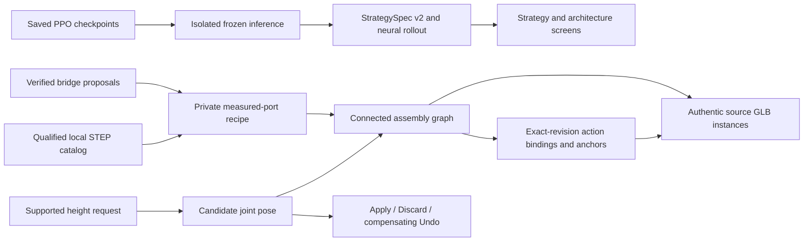

# Architecture-to-assembly integration

This production increment consumes the actual `eb1265c` bridge. It does not
regenerate research, retrain PPO, synthesize parts or treat an imported Clawbot
as a generated robot. Both saved architectures implement one learned family.

## Production services

All routes retain the existing owner session, origin and no-store protections.
The server never imports Torch. Strategy generation starts a bounded worker in
`.local/rl-venv`, loads the saved seed-17 checkpoint and executes a reproducible
seeded rollout. Manifests, source fingerprints, policy hashes, StrategySpec and
proposal provenance are checked. No training or CAD upload occurs.

| Route | Contract |
| --- | --- |
| `GET /api/strategy/status` | Supported competition/environment and frozen-runtime availability |
| `POST /api/strategy/generate` | `{competition_id: "v5-override-v2.1"}` → verified v2 specification, actual saved proposals, fresh neural rollout and simulation-only evidence |
| `POST /api/designs/realize` | `{architecture_id}` → blocked/partial session, exact missing roles, current receipts, graph, transforms, bindings and qualification |
| `GET /api/designs/{id}` | Revalidated persisted design session |
| `POST /api/designs/{id}/preview` | `{base_revision_id, configuration_id: "lower" or "raised"}` → candidate with accepted revision unchanged |
| `POST /api/designs/{id}/decision` | `{base_revision_id, action: "apply", "discard" or "undo", candidate_revision_id?}` → confirmed persisted lifecycle result |

The general capability endpoint keeps complete-robot generation unavailable.
Per-design `canEdit` independently describes whether that particular partial
assembly has qualified discrete height endpoints. Neither flag establishes
hardware actuation or whole-robot completeness.

## Private recipe contract

Recipes live at `<TACHYON_DATA_DIR>/catalog/assembly-recipes.json`, never in the
public geometry catalog. The public [JSON schema](../data/catalog/assembly-recipes.schema.json)
is generated from `RecipeBook`; it contains no component geometry or private
measurements. One recipe may bind each actual bridge alternative, A or B.

Each recipe declares:

- Exact component IDs for each realized architecture role. Template subsystem
  membership and role mappings must agree; missing roles remain missing.
- Source-hash-bound measured ports. Full rigid port frames include position and
  orientation, measured in **prepared display metres, Y-up**. Native STEP
  millimetres/Z-up and imported world matrices are not these local frames.
- A single rooted component tree, subsystems and fixed/prismatic/revolute
  relationships. Moving member sets must equal actual descendants; limits,
  parent/child frames and optional non-tree constraints are validated.
- Strategy action definitions naming real subsystem members, joints and local
  tool anchors. IDs come from the verified StrategySpec, not generated prose.
- Lower/raised configurations containing every nonfixed joint position and a
  declared reach anchor. Reach is recomputed from geometry placements and checked
  against the declaration. Every changing joint must belong to the scoring
  action and move its anchor; all moved instances must be in that action's scope.
  Raised must increase that same anchor's Y coordinate.

Placement derives `parent port × joint offset × inverse child port`. Complete
poses are validated atomically, including non-tree closure; coupled joints are
not edited one at a time through inconsistent intermediate states. The renderer
applies the resulting world matrices once and shares unchanged source geometry.
No source solid is stretched or replaced with a primitive.

Catalog identity, mesh integrity, geometry qualification, reference-only status,
assembly-placement rights and recipe fingerprints are checked when realizing,
reading and changing revisions. Recipes cannot assert their own readiness or
grant rights. Invalid or changed inputs produce precise gaps, not fallback CAD.

## Revision and linkage invariants

Preview stores a new candidate without changing accepted engineering data. Apply
accepts that exact candidate atomically; repeated identical Apply is idempotent.
Discard removes only the preview. Undo appends a compensating revision that
restores prior engineering content and rederives bindings. History is bounded;
Undo remains available when another preview would exceed the limit.

Strategy, action, component-instance and tool-anchor identities stay stable;
revision and binding hashes change with the engineering content. Parent motion
propagates to descendants, world anchors and sketch dependencies. Stale revision
links, wrong-design candidates and old source/rights/recipe hashes are rejected.
Selecting an action highlights actual bound instances and frames their bounds;
picking an instance exposes its reverse action links and hierarchy/source detail.

The assistant implements a bounded command interface, not a general engineering
LLM. It explains context, opens strategy/architectures and resolves supported
scoring-height intents. Unsupported targets, dimensions and negated requests
produce explanations without creating a candidate. Expansion controls remain
inside the top-left core in all three states and both themes.

## Verified scope and remaining work

The original three-part STEP fixture exercises a 100 mm prismatic change, a fixed
tool attachment, source rendering, reverse selection, derived anchors and the
complete revision lifecycle through real browser/API behavior. It is explicitly
**non-VEX, partial and computational**. Its 80/180 mm anchors do not meet the
learned 352 mm reach target. An anchor-height comparison is a geometric diagnostic,
not a certified task capability or a policy feedback measurement.

The actual motor/Clawbot catalog currently permits reference inspection only.
Neither has qualified generation ports, role-specific part selections or an
approved assembly-placement operation. A full robot additionally needs an
engineered BOM and subsystem recipes for chassis, drive, Pin acquisition/transfer,
scorer, independent Cup path and stack interface, including supports, fasteners,
actuation and control/power hardware. Whole-robot hardware, task and clearance
qualification is unimplemented even if those assets become available.

Endpoint checks do not prove continuous kinematics, collision-free swept motion,
torque, physical reach, game-object retention, legality or match performance.
Continuous mechanism animation and full robot co-optimization are not enabled.
See [verification and exact commands](verification/production-integration.md).
