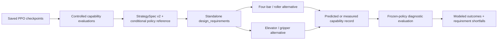

# Learned strategy to robot design interface

**Production follow-up (2026-10-24):** the standalone bridge described below is
now consumed by the running application. Frozen neural inference, StrategySpec v2
screens, actual architecture comparison and qualified private assembly/revision
interfaces are integrated. This changes the original increment's isolation
status, without modifying its experiment artifacts. Authentic complete robots
remain blocked/unimplemented. See [production verification](verification/production-integration.md).

This learner-directed `5-build` extension consumes the frozen `ac1aa01`
experiment. It adds a working structured boundary, not a new policy or a claim
that complete robots have been generated. Existing app routes, CAD, themes and
workspace code are unchanged by this increment.

The simulator and PPO implementation remain immutable. The research adapter
preserves the complete neural decision rule through checkpoint, parameter and
environment fingerprints. Context summaries and example sequences explain it;
they do not replace it. The designer is a standard-library Python module in
`server/tachyon/design.py`; it loads neither Torch, checkpoints, CAD nor the app.
It can run in the ordinary app environment or any Python 3.12 environment with
`PYTHONPATH=server`. No production endpoint has been enabled.

`StrategySpec` v2 carries competition/environment identities, the original
experiment and checkpoint, objectives, conditional preferences, executable
inference contract, representative traces, capability requirements, mechanical
requirements, uncertainty, evidence hashes and limitations. Its content identity
and frozen environment are checked before inference/feedback. The designer
validates declared provenance structurally; experiment verification checks the
actual checkpoint and source bytes separately.

The designer produces machine-readable drive, intake, transfer, scoring reach,
cycle-time and capability constraints. Both proposals consume **identical learned
requirements for the same family**. Engineering choices and numeric dimensions
are labeled intents; actual component selection, rights, mounting frames,
attachments, actuation, clearance and physical tests remain required. Semantic
action-to-subsystem intents are not verified strategy-to-CAD links.

Feedback v2 names the strategy, environment, design proposal/revision, source
(`predicted`, `measured`, or `abstract_simulation`), method, evidence, conditions,
units, nominal capabilities and uncertainty bounds. A supplied measurement label
is provenance, not automatic physical certification. Values are not silently
projected onto the abstract budget. Nominal diagnostic evaluation reports inherited
movement/toggle assumptions, shortfalls, action frequencies and modeled outcomes.
Its intervals exclude uncertainty in supplied estimates; acceleration is recorded
but unused because the original environment does not model it. There is no
retraining, automatic optimization loop or diffusion model.

The [experiment report](../research/strategy_rl/results/strategy-design-bridge-v1/REPORT.md)
contains the controlled results, limitations, exact commands, artifacts and
verification. It distinguishes marginal simulator interventions, feasible abstract
budget controls and engineering hypotheses. The original experiment remains
unchanged. Full application acceptance, authentic generated robots and learner
hands-on reviews remain pending.
