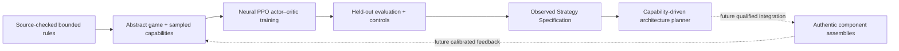

# Strategy-first reinforcement learning

The learner requested this architecture change on 2026-10-24, after the app and
private STEP pipeline had already begun. This is an isolated, newly implemented
research increment, not retroactive evidence that the application was planned
around RL or that its complete robot workflow works.

The [independent package](../research/strategy_rl/README.md) has its own Python
environment and dependencies. No CAD design is needed to reset or train the
environment. The frontend, server and CAD pipeline do not import this package.
No diffusion model or multi-agent robotics framework was added.

Implemented boundaries:

- The versioned scenario separates selected official scoring/possession facts
  from authored coordinates, durations, probabilities and budget assumptions.
- The environment produces normalized observations and legal action masks;
  PPO trains a two-layer neural actor and critic with stochastic on-policy
  samples, GAE, clipped objectives and real Adam gradient updates.
- Frozen inference verifies the checkpoint, training evidence and exact
  environment/scenario fingerprints. Unsupported/malformed states fail clearly.
- Held-out random, heuristic and same-network untrained controls share the
  capability configurations, episode seeds and hidden opponent event schedules.
- Rollouts yield scored objectives, sequences, movement, observed trade-offs and
  jointly supported capability targets. Minimums describe a representative
  modeled sequence, not certified physical limits.
- The architecture planner consumes that specification to choose drive,
  acquisition, independent Pin/Cup transfer and scoring recipes, plus numeric
  layout intent. It explicitly reports unresolved authentic components,
  connections, actuation, physical checks and complete-robot status.
- A future capability-feedback interface distinguishes estimates, measurements
  and abstract simulation. Calibration and the automatic co-design loop are
  not implemented.

Three independent runs completed 786,432 simulated decisions and 12,288 gradient
updates. On 192 held-out cases per policy, PPO means were 38.15–38.46 modeled
points, versus 32.30 for the specified heuristic and 3.45 for valid-action random
play. These are **abstract simulated strategy results only**. A full seed-17
repetition reproduced identical parameter hashes.

All 576 trained-policy evaluation episodes support one low-quadrant scoring
family. No second elevated family met the fixed support gate. One architecture
proposal was emitted; a synthetic high-reach contract test is not discovery
evidence. This does not establish that a different strategy cannot succeed.

The [preserved experiment](../research/strategy_rl/results/override-ppo-v1/REPORT.md)
contains checkpoints, metrics, compressed rollouts, source hashes, plots and
verification. Inference and isolated strategy-to-designer checks are verified;
production integration, generated authentic robot assemblies, a second learned
architecture and physical performance remain unimplemented or unverified. No
existing Devpost application acceptance box is passed by this research evidence.

## Frozen-policy design handoff extension

The learner subsequently requested the missing structured interface. The
[new handoff](strategy-design-interface.md) adds capability sweeps, a conditional
StrategySpec v2, a standalone designer producing two engineering alternatives
for the same learned family, and one-shot capability feedback. It reuses the
original checkpoints without training or replacement. Its results and integration
checks are recorded separately from the original experiment. A second learned
strategy and authentic generated CAD remain unestablished.
