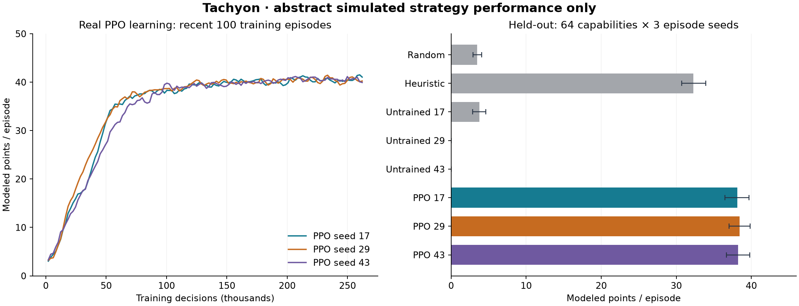
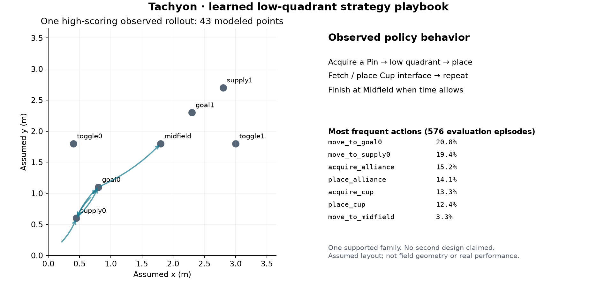

# Override abstract PPO experiment v1

Recorded 2026-10-24. **Every performance number is abstract simulated strategy
performance, not validated real robot or match performance.** This isolated
experiment does not pass the application's authentic-CAD or complete-robot gates.

## Executed training

Competition facts → authored abstract game → stochastic neural PPO training
across sampled capabilities → frozen evaluation → observed strategy extraction
→ capability-driven mechanical architecture proposal. No initial CAD design,
robot identity, deterministic action ranking reward, diffusion model or private
robotics code is used.

| Training seed | Simulated decisions | Adam gradient updates | Completed episodes | Parameter change L2 |
| --- | ---: | ---: | ---: | ---: |
| 17 | 262,144 | 4,096 | 4,766 | 6.929085 |
| 29 | 262,144 | 4,096 | 4,817 | 6.795636 |
| 43 | 262,144 | 4,096 | 4,750 | 7.098442 |

Total: **786,432 decisions, 12,288 gradient updates, 14,333 completed episodes**
across three independent training seeds. Each rollout batch contains 16 workers
× 128 decisions. The actor–critic has two 64-unit tanh layers, a masked
Categorical actor and scalar critic. GAE λ=.95, PPO clip=.2, Adam learning
rate=.0003, four epochs, minibatches of 256, entropy coefficient=.015 and gradient
clip=.5. Gamma=1; raw score deltas are multiplied by .1 for training stability.
There is no ranking reward or action-sequence teacher.

A fourth execution repeats seed 17 from scratch for all 262,144 decisions. Its
full neural parameter hash matches exactly:
`b9d0ff5931f9a5c35b2fb407d5051ee08a698a83ad7cfc8537d1967bd60eb5f1`.
This is reproducibility evidence, not a fourth independent seed. Exact numerical
reproduction was verified on CPU/macOS arm64 with the recorded dependencies;
other platforms/PyTorch releases may differ. Checkpoints are not a mid-episode
resume implementation.

## Held-out evaluation

64 unseen capability seeds × 3 episode seeds = **192 cases for each policy**;
8 policies yield **1,536 evaluated episodes**. The first 32 capability samples
use the training distribution (Dirichlet concentration 2), while 32 use budget
corners (concentration .65). Capability and episode seed ranges are separate
from training. Case definitions were fixed before running evaluation.

Evaluation uses deterministic argmax of each frozen neural policy. Random play
samples uniformly among legal actions. The specified heuristic uses visible
state to choose short routes, handle one Pin and one Cup, prepare stack
interfaces, and preserve time for Midfield. All policies share held-out case
seeds and the same separately sampled hidden toggle-recapture schedules; neither
policy sees future opponent events. This compares against this particular
heuristic, not every possible hand-designed strategy or an optimal solver.

| Policy | Mean modeled points | 95% mean interval | Unseen IID capabilities | Budget-corner stress |
| --- | ---: | --- | ---: | ---: |
| random | 3.45 | [2.90, 4.06] | 3.32 | 3.58 |
| heuristic | 32.30 | [30.73, 33.91] | 34.09 | 30.50 |
| untrained_seed_17 | 3.75 | [2.88, 4.62] | 3.83 | 3.67 |
| untrained_seed_29 | 0.00 | [0.00, 0.00] | 0.00 | 0.00 |
| untrained_seed_43 | 0.00 | [0.00, 0.00] | 0.00 | 0.00 |
| ppo_seed_17 | 38.15 | [36.51, 39.70] | 40.49 | 35.81 |
| ppo_seed_29 | 38.46 | [37.03, 39.84] | 40.54 | 36.39 |
| ppo_seed_43 | 38.25 | [36.67, 39.81] | 40.62 | 35.88 |

Intervals resample 64 capability clusters, preserving each cluster's three
episode seeds (2,000 bootstrap samples). They do not treat the 192 repeated cases
as independent capabilities. They quantify case uncertainty conditional on the
trained seed and authored environment; they are not real-world confidence bounds.

Paired PPO minus heuristic differences on the same cases:

- Seed 17: +5.85 modeled points; 95% paired interval [4.55, 7.15].
- Seed 29: +6.17 modeled points; 95% paired interval [4.94, 7.40].
- Seed 43: +5.95 modeled points; 95% paired interval [4.70, 7.21].

Stress-case performance is lower. Three training seeds and this bounded test
set do not establish global optimality or reliability on other rulebooks.
Untrained controls use the same architectures and their actual initial weights.
Their poor scores, along with real updates, changed weights, learning curves and
replayable checkpoints, support that these reported policies were trained.

## Extracted strategy and resulting architecture

All **576 trained-policy evaluation episodes**, spanning 64 held-out capability
configurations and three training seeds, support **one low-quadrant cycle family**.
The fixed family support gate requires 24 episodes, 8 capability configurations
and 2 training seeds. The elevated family has zero qualifying episodes. No second
learned architecture is emitted. This is not proof that an elevated strategy is
inferior or impossible; the start, layout, stocks, timing assumptions and limited
exploration favor certain patterns.

The exported [Strategy Specification](strategies/low_quadrant_cycles-strategy.json)
records preferred objectives, action frequencies, observed transitions, movement,
full representative trace, observed timing/ownership/parking trade-offs, jointly
supported capability targets, mechanism requirements and checkpoint hashes.

The representative rollout scores 43 modeled points and reaches an assumed
maximum placement height of .352 m. Its associated capability sample has target
drive speed 1.323 m/s, acquisition time 2.459 s and placement time 1.944 s. These
are simulated targets, not measurements or proof of mechanical feasibility.
Minimums apply only to this representative modeled sequence. The target vector
comes from one observed feasible abstract budget sample; it does not combine
independently favorable marginal capabilities.

The [architecture proposal](strategies/low_quadrant_cycles-architecture.json)
chooses two-motor linked geared differential drive with four driven wheels,
guided opposed intake rollers, a single-Pin gated handoff, independent Cup
handling and a four-bar Pin gripper. It includes numeric chassis/wheel positions,
provisional wheel-to-motor speed ratio, intake mouth and link-length intent.
These are deterministic design decisions downstream of learned requirements,
not another learning model. **They are not CAD geometry or a complete robot.**
Authentic component resolution, connections, actuation, contact, stability,
torque and full competition legality remain unverified.

## What the environment does and does not mean

Selected rules were source checked against the
[official Override v2.1 manual](https://manuals.vex.com/v5/override/v2.1/game/?view=core).
Five/ten points refer to a scored visible Pin Half, not a whole Pin. The model
assumes one counted visible half per token, idealized Pin orientation and Cup
orientation preserving earlier halves. Possession is one Pin and one independent
Cup (SG6). Repeated stack placement requires Cup preparation (SC2).

The [scenario](../../tachyon_strategy_rl/scenario.json) distinguishes these facts
from all authored assumptions. Two abstract quadrant interfaces are modeled;
the elevated target is not the official central Midfield Goal. Coordinates,
heights, stocks, abstract resource budgets, movement/action distributions and
opponent process are assumptions. The 15-second park macro window is not claimed
to be the official Endgame rule. Contact physics, object stability, real field
geometry, autonomous, teammates and full legality are excluded. Converting an
arbitrary uploaded rulebook into an environment is not implemented.

## Evidence and verification

- [Evaluation and exact cases](evaluation/evaluation.json), with per-policy
  losslessly compressed JSONL files beside it. PPO files retain full traces.
- [Seed 17](runs/seed-17/training-summary.json),
  [seed 29](runs/seed-29/training-summary.json) and
  [seed 43](runs/seed-43/training-summary.json), each with initial/final `.pt`
  checkpoints, Adam state, training metrics and code fingerprints.
- [Full-run reproduction](reproduction.json) and its independently produced
  checkpoint/logs under `reproduction-seed-17/`.
- [Family support and honest availability](strategies/strategy-manifest.json).
- `manifest.json` hashes the preserved artifacts; `provenance.json` records the
  lossless packaging and checkpoint-path normalization. No user CAD, manual PDF,
  manufacturer asset or private project is bundled.
- The package test suite passes **77 tests**: environment scoring/state/possession
  and timing oracles, GAE, actual updates, deterministic training, legal actions,
  baselines, clustered evaluation, inference and strategy/designer contracts.
  Synthetic two-recipe contract fixtures are not learned-strategy evidence.
- `verification.json` records full deterministic held-out replay and isolated
  inference/export checks. See the [reproduction commands](../../README.md).

Training-time fingerprints are retained as recorded. Subsequent inference gates,
compressed-rollout support, strategy/designer export and reporting were added
without changing the trained environment, scenario or neural PPO implementation.
The preserved results are validated against those unchanged training sources.

The app frontend, themes, mobile CAD viewer and backend remain separate and were
not modified by this experiment. Production integration is not enabled. Future
robot capability feedback has a versioned interface, with calibration and an
automatic iterative loop explicitly pending. **Two distinct learned designs,
authentic generated CAD assemblies and physical performance are not established.**
