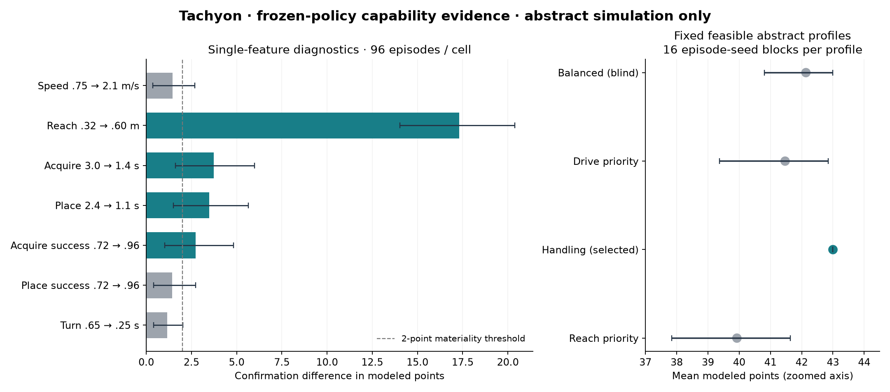

# Frozen PPO strategy to mechanical design specification

Recorded 2026-10-24. Source experiment: `override-ppo-v1`, commit `ac1aa01`.
**Abstract simulated strategy performance only; no physical robot performance,
complete CAD robot, new learned strategy family or model training is claimed.**

## Delivered interface

The saved policy and simulation evidence now produce a versioned
[StrategySpec v2](strategy-spec-v2.json), consumed by the standalone, Torch-free
`server/tachyon/design.py` designer. The actual executable chain is:

Saved checkpoints → frozen capability experiments → conditional StrategySpec →
structured mechanical requirements → two engineering architecture alternatives.

The [requirements](design/design-requirements.json) contain drive/turn targets,
independent one-Pin/one-Cup possession, oriented intake and transfer, scoring and
Cup-interface reach, action reliability and cycle-time constraints. The
[two proposals](design/architecture-proposals.json) implement **the same learned
low-quadrant strategy family**:

| Alternative | Mechanical intents |
| --- | --- |
| A | Linked geared four-wheel tank drive; opposed rollers and orientation guides; gated Pin handoff; four-bar gripper; independent Cup cradle |
| B | Chain-linked six-wheel drop-center drive; parallel-jaw pickup; linear Pin shuttle; guided elevator/gripper; independent Cup cradle |

They have identical learned requirements and different mechanical signatures,
geometry/sizing intents, support layouts and attachment/joint intents. The
mechanism choices, assumed motor RPM, gear ratios, tool margins and dimensions
are engineering hypotheses, not learned hardware or selected authentic parts.
No actual part identities, mates, solid geometry, kinematic qualification or CAD
rendering are invented. Every proposal reports `completeRobot: false`,
`cadGenerated: false` and physical qualification pending. Semantic action links
are subsystem intents, not verified links to existing CAD instances.

## Controlled frozen-policy study

**6,144 unique evaluation episodes**, independently repeated without changing any
weights; the complete rollout archives match byte-for-byte. Calibration and
confirmation each contain 16 fresh capability seed blocks × 2 episode seeds ×
3 original PPO checkpoints = 96 episodes per cell. Their seed ranges are disjoint
from training, the original evaluation and each other.

There are 32 cells per stage: reference; three levels for each of seven effective
capabilities; six coupled budget transfers; and four fixed abstract simplex
profiles. Single-feature interventions hold other effective properties constant
and update both the policy observation and environment dynamics. They are outside
the training joint capability manifold, even when marginal values are in range.
They establish simulator sensitivity, not separately realizable hardware effects.

The six budget transfers keep the drive/handling/lift simplex feasible but change
several effective properties together. They corroborate resource trade-offs, not
single-variable causation. Each fixed profile is **one actual capability vector**
evaluated across 16 episode-seed blocks; those blocks are not 16 different robot
capabilities. Both counts and their interval units are recorded separately.

Paired intervals resample 16 seed blocks (2,000 bootstrap samples), retaining
both episode repetitions and the three fixed trained policies within a block.
The prespecified materiality rule is an absolute mean difference of at least two
modeled points with an interval excluding zero, in the same direction in both
stages. These are exploratory intervals without multiplicity correction and do
not quantify uncertainty over all possible training seeds or physical systems.

| Intervention, preferred minus adverse | Confirmation modeled-point difference | 95% interval | Material in both stages |
| --- | ---: | --- | --- |
| Speed .75 → 2.1 m/s | +1.45 | [0.36, 2.68] | No |
| Reach .32 → .60 m | +17.30 | [14.03, 20.38] | Yes |
| Acquire 3.0 → 1.4 s | +3.73 | [1.62, 5.98] | Yes |
| Place 2.4 → 1.1 s | +3.49 | [1.51, 5.66] | Yes |
| Acquire success .72 → .96 | +2.73 | [1.02, 4.83] | Yes |
| Place success .72 → .96 | +1.43 | [0.41, 2.74] | No |
| Turn .65 → .25 s | +1.16 | [0.41, 2.02] | No |

Reach .32 m yields 22.92 mean modeled points; .36 m yields 40.28 and .60 m yields
40.22 in confirmation. Extra reach above the low-stack requirement shows no
improvement in these cells. This supports low-stack reach sufficiency within
this model, not a universal physical minimum. Faster acquisition/placement and
acquisition reliability have replicated material effects. Smaller speed,
placement-reliability and turn-time effects do not satisfy the declared replicated
materiality rule. No acceleration dynamics exist; turn overhead is not acceleration.



## Conditional strategy, sequences and targets

Original rollouts favor alliance-colored scoring halves and repeated low-goal
Pin/Cup cycles, using short supply0 ↔ goal0 travel and eventual Midfield positioning.
The v2 spec retains source action frequencies, cycle transitions and movement
statistics, plus three near-mean calibration rollout examples. They illustrate
behavior rather than prescribe one fixed sequence.

Observed context guards cover time band, location, Pin/Cup inventory, low-stack
interface readiness and reachability. Their average neural preferences agree
with 95.65% of covered confirmation decisions, with 99.96% context coverage.
That approximation is descriptive and pools the three fixed policies. It is
**not** the executable controller. `FrozenStrategyController` loads the original
seed-17 checkpoint by file/parameter hash and checks the environment, source code,
observation/action contract and content-derived spec ID before returning neural
probabilities and a state-dependent legal action. Unseen descriptive contexts
still use that neural policy; malformed/out-of-domain input fails.

Targets use the jointly supported handling-priority abstract profile selected on
calibration: drive 1.15 m/s, turn overhead .575 s, acquisition 2.0 s, placement
1.6 s, acquisition success .868 and placement success .871. Required reach
.352 m covers Pin **and Cup** tasks in the original representative simulated
sequence and the observed calibration task envelope. This is not an identified
physical minimum. The preferred reach floor is below the reference profile's
maximum .455 m; maximum modeled capability is not confused with required reach.

The median successful scoring interval is 9.811 s for the selected abstract
profile. Recurring cycles require two acquisitions (Pin and Cup) and two
placements. The nominal serial action budget is 7.2 s, leaving about 2.611 s for
travel, failures and other work; no achieved hardware timing is asserted. The
first Pin can omit Cup preparation. Mechanism timing allocations and transmissions
must be tested on real assemblies.

## Strategy-aware versus strategy-blind comparison

The strategy-aware selector chooses among four declared feasible abstract
capability profiles using calibration frozen-policy scores. It selects handling
priority. The blind control is the balanced profile, fixed without consulting
strategy evidence. Confirmation means are 43.00 versus 42.14 modeled points:
**+0.86, paired 95% interval [0.00, 2.19]**. This is inconclusive evidence of an
advantage and does not meet the materiality rule. It is a capability-profile
proxy comparison, not an evaluation of either mechanical topology. The fixed
policies nearly saturate their observed alliance-only cycle in these profiles.

## Capability feedback is functional and limited

[Nominal](feedback-nominal-input.json) and
[restricted-reach](feedback-restricted-reach-input.json) records reference the
actual alternative-A proposal ID and its design-spec revision. They contain
**illustrative predicted inputs**, not CAD-derived predictions or measurements.
Their source, method, units, test conditions, per-field uncertainty and evidence
labels are preserved. Supplied values are not silently projected onto the simplex.

With all other supplied inputs held fixed, reach .455 m yields 43.0 mean modeled
points and seven scoring placements; reach .32 m yields 20.0 and four placements
on 32 shared episode seeds. Actual neural action frequencies differ. The latter
returns a structured reach-shortfall recommendation; the former reports nominal
targets met while requiring mechanism verification. This demonstrates a working
capability → policy evaluation → design-feedback boundary, not successful
adaptation to every constrained robot. Off-manifold inputs can perform poorly.

The results expose inherited movement/Toggle reliability and unchanged scenario
assumptions separately from supplied values, and record the evaluator hash.
Intervals describe simulation randomness at nominal input values, **not** the
uncertainty bounds supplied with predictions. Zero-width intervals in these
saturated finite cases do not imply physical certainty. Acceleration is retained
as explicitly unused metadata. No optimizer, automatic co-design loop or diffusion
model runs. Measured provenance would still require calibration and validation.

## Verification status

- **Passing:** 102 RL/adapter tests; 433 backend tests including 166 new designer
  contract cases; 49 frontend tests; TypeScript/production build.
- **Passing:** source experiment's 34 preserved files unchanged; all three frozen
  checkpoints verified; 64 result cells and paired effects recomputed; 192
  representative interventions replayed exactly; full 6,144-record study
  reproduction; actual standalone designer CLI reproduced; 64 feedback episodes
  replayed; changed reach changes policy behavior and recommendations.
- **Passing:** malformed records, environment/content mismatch, archive tampering,
  invalid numbers/probabilities, unqualified provenance and overwrite attempts
  fail explicitly. Designer import/CLI tests verify no Torch, NumPy, research,
  app or CAD modules are loaded.
- **Failing:** no current failure in these executed checks.
- **Unimplemented/unverified:** authentic CAD realization, mechanically qualified
  capabilities, real strategy-to-CAD links, acceleration response, production UI
  integration and full co-optimization. These cannot pass application P0 gates.
- **Preserved:** existing demo routes, frontend and CAD work. No new browser or
  physical-phone review was performed for this backend-only interface increment.

`verification.json` records executed checks; `manifest.json` hashes artifacts and
sources. `reproduction.json` records the full frozen replay. The original
`override-ppo-v1` experiment and model files are unchanged. Existing Devpost
planning approvals and pending application/learner review gates remain intact.

## Exact reproduction commands

From the repository root, use the separate environment described in
[the package README](../../README.md). Outputs deliberately use new paths.
Python 3.12, Torch 2.10.0, NumPy 2.3.5 and deterministic CPU inference were used.

```sh
.local/rl-venv/bin/python -m tachyon_strategy_rl.handoff analyze \
  --experiment research/strategy_rl/results/override-ppo-v1 \
  --output .local/strategy-rl/reproduce-handoff-analysis --configurations 16 --episodes 2

.local/rl-venv/bin/python -m tachyon_strategy_rl.handoff export \
  --experiment research/strategy_rl/results/override-ppo-v1 \
  --analysis .local/strategy-rl/reproduce-handoff-analysis \
  --output .local/strategy-rl/reproduce-strategy-v2.json

PYTHONPATH=server .venv/bin/python -m tachyon.design \
  --strategy .local/strategy-rl/reproduce-strategy-v2.json \
  --output .local/strategy-rl/reproduce-design

.local/rl-venv/bin/python -m tachyon_strategy_rl.handoff feedback \
  --experiment research/strategy_rl/results/override-ppo-v1 \
  --strategy research/strategy_rl/results/strategy-design-bridge-v1/strategy-spec-v2.json \
  --input research/strategy_rl/results/strategy-design-bridge-v1/feedback-restricted-reach-input.json \
  --output .local/strategy-rl/reproduce-reach-feedback.json

.local/rl-venv/bin/python research/strategy_rl/tools/verify_handoff.py \
  --root research/strategy_rl/results/strategy-design-bridge-v1 \
  --experiment research/strategy_rl/results/override-ppo-v1 --designer-python .venv/bin/python

.local/rl-venv/bin/python -m pytest research/strategy_rl/tests -q
.venv/bin/python -m pytest server/tests -q
npm run test --prefix web -- --run
npm run build --prefix web
```

Frozen checkpoints, not a fixed action script or deterministic strategy ranking
function, supply the decisions. The deterministic designer only realizes supplied
requirements as engineering intents. No proprietary CAD, private robotics
implementation or remote asset upload is part of this increment.
